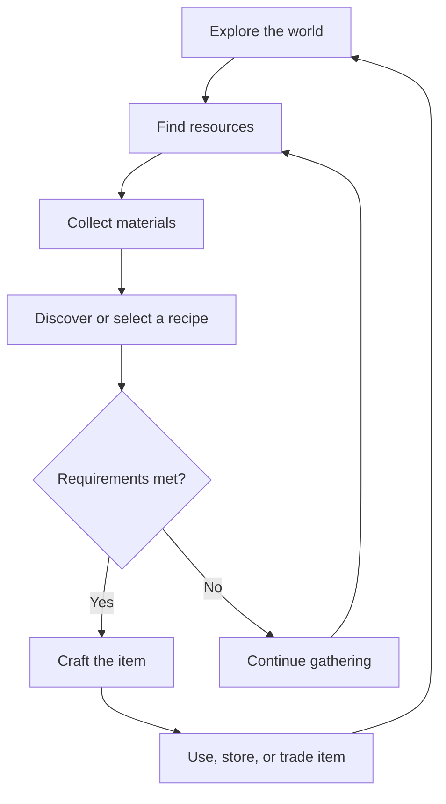
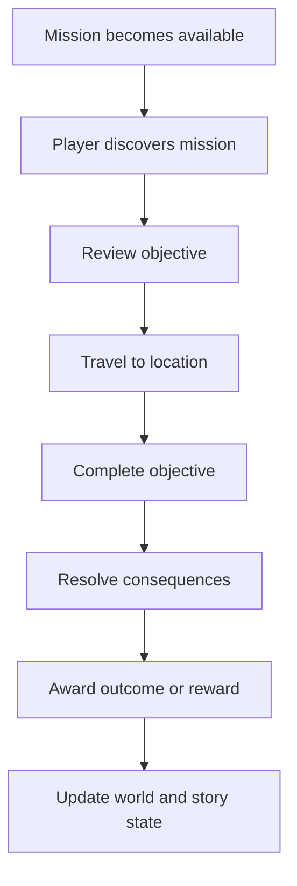
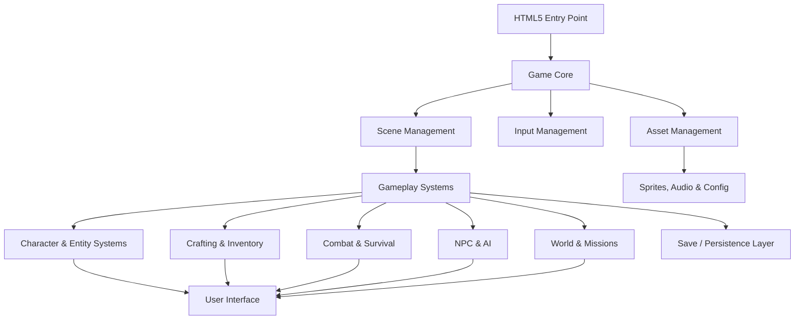

# 🧟🔥 PHOENIX BLAZE
### A Conscious Zombie Survival Game

<p align="center">
  <strong>RISE FROM THE DEAD. KEEP YOUR HUMANITY. SURVIVE THE APOCALYPSE.</strong>
</p>

<p align="center">
  🌋 OPEN WORLD &nbsp;•&nbsp; 🧠 CONSCIOUS UNDEAD &nbsp;•&nbsp; 🍃 SURVIVAL CRAFTING &nbsp;•&nbsp; 🎭 MORAL CHOICES
</p>

<p align="center">
  
  
  
  
  
</p>

---

# 📑 TABLE OF CONTENTS

| # | Section | Description |
|---|---|---|
| 01 | [🌋 Overview](#-overview) | Enter the world of Phoenix Blaze |
| 02 | [🎮 Core Features](#-core-features) | Gameplay systems and mechanics |
| 03 | [🧠 Game Identity](#-game-identity) | The world, player, and survival concept |
| 04 | [🏗️ Project Structure](#️-project-structure) | Source code and directory architecture |
| 05 | [⚙️ Technology Stack](#️-technology-stack) | Development technologies |
| 06 | [🚀 Getting Started](#-getting-started) | Installation and setup |
| 07 | [🕹️ Gameplay Systems](#️-gameplay-systems) | Core gameplay architecture |
| 08 | [🗺️ Development Roadmap](#️-development-roadmap) | Four development phases |
| 09 | [🧪 Testing & Quality](#-testing--quality) | Testing and optimization |
| 10 | [🤝 Contributing](#-contributing) | Development participation |
| 11 | [📚 Documentation](#-documentation) | Project documentation |
| 12 | [📖 Glossary](#-glossary) | Game and development terminology |
| 13 | [🔐 License](#-license) | Ownership and licensing |
| 14 | [📡 Contact](#-contact) | Project information |
| 15 | [🎬 Creative Direction & Worldbuilding](#-creative-direction--worldbuilding) | Narrative pillars, atmosphere, and tone |
| 16 | [🗺️ World Regions & Environment Design](#️-world-regions--environment-design) | Region planning and environmental storytelling |
| 17 | [🧍 Character Design & Progression](#-character-design--progression) | Identity, attributes, progression, and customization |
| 18 | [🧟 Zombie Ecology & Factions](#-zombie-ecology--factions) | Undead behavior, threat types, and group dynamics |
| 19 | [🧑‍🤝‍🧑 Human Survivors & Relationships](#-human-survivors--relationships) | Trust, reputation, dialogue, and social systems |
| 20 | [🎒 Inventory, Loot & Equipment](#-inventory-loot--equipment) | Item categories, storage, and equipment concepts |
| 21 | [🛠️ Crafting, Recipes & Resources](#️-crafting-recipes--resources) | Gathering, recipe discovery, and crafting loops |
| 22 | [🧭 Exploration, Missions & Events](#-exploration-missions--events) | Objectives, encounters, and discovery |
| 23 | [🧩 User Interface & Accessibility](#-user-interface--accessibility) | HUD, menus, input, readability, and accessibility |
| 24 | [🎧 Audio & Visual Effects](#-audio--visual-effects) | Soundscape, animation, lighting, and feedback |
| 25 | [💾 Save System & Game Data](#-save-system--game-data) | Persistence, checkpoints, and data integrity |
| 26 | [⚖️ Balance, Difficulty & Player Choice](#️-balance-difficulty--player-choice) | Tuning principles and consequence design |
| 27 | [🔒 Security, Privacy & Mature-Content Boundaries](#-security-privacy--mature-content-boundaries) | Safe implementation and content controls |
| 28 | [🚦 Performance & Browser Compatibility](#-performance--browser-compatibility) | Optimization and supported environments |
| 29 | [🧱 Architecture & Data Flow](#-architecture--data-flow) | Proposed system boundaries and data flow |
| 30 | [🧰 Developer Workflow & Git Practices](#-developer-workflow--git-practices) | Branches, commits, reviews, and debugging |
| 31 | [📦 Release & Build Checklist](#-release--build-checklist) | Packaging and release readiness |
| 32 | [🧾 Requirements & Acceptance Criteria](#-requirements--acceptance-criteria) | Feature definition and completion checks |
| 33 | [🧪 Test Scenarios](#-test-scenarios) | Example gameplay and system test cases |
| 34 | [🗓️ Expanded Milestones](#️-expanded-milestones) | Detailed milestone planning |
| 35 | [❓ FAQ](#-faq) | Frequently asked questions |
| 36 | [🧠 Design Principles](#-design-principles) | Rules that guide the experience |
| 37 | [🧷 Documentation Conventions](#-documentation-conventions) | Labels, status markers, and formatting |
| 38 | [🧭 Future Expansion Ideas](#-future-expansion-ideas) | Optional ideas for later consideration |
| 39 | [📜 Credits & Acknowledgments](#-credits--acknowledgments) | Project attribution |
| 40 | [⬆️ Back to Top](#-phoenix-blaze) | Return to the beginning |

---

# 🌋 OVERVIEW

**Phoenix Blaze** is an innovative HTML5-based open-world sandbox survival game where you play as a newly-turned zombie who retains human consciousness.

Manage your bloodlust with cannabis-based crafting, blend in with both humans and zombies, and navigate a post-apocalyptic world of survival, moral choices, and self-discovery.

You aren't just another zombie.

You're something different.

You're caught between two worlds: the instinct to consume and the desire to remain human.

Every decision matters. Every encounter carries consequences. Every survivor has a story.

<details>
<summary>🔥 <strong>THE PHOENIX BLAZE PREMISE</strong></summary>

A new existence begins after death.

Your character awakens as a zombie, but something unexpected has happened: your consciousness survived the transformation.

You retain memories, emotions, reasoning, and the ability to make choices.

However, your body has developed instincts that constantly threaten your remaining humanity.

The challenge isn't simply surviving the apocalypse.

It's deciding what kind of creature you will become.

</details>

## 🎯 Core Features

| Feature | Description | Category |
|---|---|---|
| 🧟 **Play as a Conscious Zombie** | Retain fragments of humanity while battling zombie instincts | Character |
| 🍃 **Cannabis Integration** | Craft marijuana-based items to suppress bloodlust and enhance abilities | Crafting |
| 🎭 **Stealth & Disguise** | Blend in with humans or mimic zombie behavior | Stealth |
| 🔨 **Deep Crafting System** | Create tools, weapons, shelters, and survival gear from gathered materials | Survival |
| 🌍 **Open-World Exploration** | Semi-open world with 6-8 diverse regions | Exploration |
| 🤖 **AI-Driven NPCs** | Dynamic interactions with human survivors and other zombies | Intelligence |
| 🎮 **Moral Decision-Making** | Branching storylines based on player choices | Story |
| 🔞 **Mature Content** | NSFW character customization and relationship mechanics | Mature |

---

# 🧠 GAME IDENTITY

<details>
<summary>🧟 <strong>THE PLAYER: HUMANITY INSIDE THE UNDEAD</strong></summary>

The player character occupies a unique position in the post-apocalyptic world.

**Human characteristics:**
- Memories and identity.
- Reasoning and decision-making.
- Emotional responses.
- Social interaction.
- Moral judgment.

**Zombie characteristics:**
- Bloodlust and hunger.
- Physical deterioration.
- Instinctive behavior.
- Hostile zombie encounters.
- Survival-driven abilities.

The tension between these characteristics creates the central gameplay experience.

</details>

<details>
<summary>🍃 <strong>CANNABIS-BASED SURVIVAL CRAFTING</strong></summary>

Cannabis integration is a distinctive gameplay mechanic.

It provides a crafting and progression system involving fictional consumables, recipes, and survival applications.

Potential mechanics include:

- Bloodlust management.
- Temporary ability enhancements.
- Craftable calming items.
- Resource gathering.
- Recipe discovery.
- Character progression.

</details>

<details>
<summary>🎭 <strong>STEALTH, DISGUISE & SOCIAL SURVIVAL</strong></summary>

The player must navigate encounters with two fundamentally different populations.

**Human survivors**
- Suspicion and trust.
- Social interactions.
- Disguise recognition.
- Reputation and consequences.

**Zombie populations**
- Behavioral mimicry.
- Threat detection.
- Hostile encounters.
- Environmental awareness.

</details>

---

# 🏗️ PROJECT STRUCTURE

The project follows a modular architecture designed to separate gameplay logic, entities, assets, interface components, and supporting utilities.

```text
zombie/
│
├── src/
│   │
│   ├── game/
│   │   ├── core/           # Core game engine
│   │   ├── systems/        # Game systems (crafting, combat, AI)
│   │   ├── entities/       # Player, enemies, NPCs
│   │   └── ui/             # HUD, menus, inventory
│   │
│   ├── assets/             # Sprites, audio, configs
│   ├── utils/              # Helper functions
│   └── index.html          # Main entry point
│
├── docs/                   # Documentation
├── tests/                  # Unit and integration tests
├── config/                 # Configuration files
├── package.json
└── README.md
```

## 📂 Directory Responsibilities

| Directory | Responsibility |
|---|---|
| `src/game/core/` | Core game engine and initialization |
| `src/game/systems/` | Crafting, combat, AI, and gameplay logic |
| `src/game/entities/` | Player, enemies, and NPC entities |
| `src/game/ui/` | HUD, menus, and inventory |
| `src/assets/` | Sprites, audio, and configurations |
| `src/utils/` | Shared helper functions |
| `docs/` | Technical and gameplay documentation |
| `tests/` | Automated testing |
| `config/` | Project configuration |

---

# ⚙️ TECHNOLOGY STACK

The technology foundation uses established web-development tools and a browser-based 2D game engine.

| Component | Technology | Purpose |
|---|---|---|
| 🎮 Framework | Phaser 3 | 2D game engine for web |
| 💻 Language | JavaScript (ES6+) | Game logic and application code |
| 📦 Build Tool | Webpack / Parcel | Bundling and development builds |
| 🧪 Testing | Jest | Automated testing |
| 🌿 Version Control | Git | Source control and collaboration |
| 🌐 Platform | HTML5 | Browser-based delivery |

### 🧩 Technology Highlights

- **Phaser 3:** Scene management, rendering, physics, input, and game objects.
- **JavaScript ES6+:** Modern modular application development.
- **Webpack/Parcel:** Asset processing and production bundling.
- **Jest:** Automated unit and integration testing.
- **Git:** Version history and collaborative development.

---

# 🚀 GETTING STARTED

Ready to rise from the grave?

Follow the instructions below to get the project running locally.

## 📋 Prerequisites

| Requirement | Version |
|---|---|
| Node.js | v14+ |
| npm | Compatible with installed Node.js |
| Yarn | Optional alternative package manager |
| Git | Recommended |

## 📥 Installation

### Step 1: Clone the repository

```bash
git clone https://github.com/reeferguyai/zombie.git
```

### Step 2: Enter the project directory

```bash
cd zombie
```

### Step 3: Install dependencies

```bash
npm install
```

### Step 4: Start the development server

```bash
npm run dev
```

### Step 5: Build for production

```bash
npm run build
```

## 🖥️ Development Commands

| Command | Action |
|---|---|
| `npm install` | Install project dependencies |
| `npm run dev` | Start development server |
| `npm run build` | Create production build |

> 💡 **Development Note:** The actual available scripts are determined by `package.json`. The commands above preserve the original project's documented setup.

---

# 🕹️ GAMEPLAY SYSTEMS

This section organizes the major gameplay concepts into functional development categories.

The following is an expanded architectural guide, not a claim that all systems have already been implemented.

## 🧟 1. Character & Identity System

Potential responsibilities:

- Character creation.
- Character appearance.
- Human consciousness.
- Zombie transformation.
- Character progression.
- Relationship attributes.

## 🩸 2. Bloodlust Management

Potential responsibilities:

- Bloodlust meter.
- Instinctive behavior.
- Hunger progression.
- Player control consequences.
- Suppression mechanics.
- Survival decisions.

## 🍃 3. Crafting & Resource System

Potential responsibilities:

- Resource collection.
- Item recipes.
- Crafting stations.
- Cannabis-based fictional crafting.
- Survival equipment.
- Inventory management.

## 🎭 4. Stealth & Disguise System

Potential responsibilities:

- Human disguise.
- Zombie behavioral mimicry.
- Suspicion detection.
- NPC recognition.
- Stealth encounters.

## 🤖 5. AI & NPC System

Potential responsibilities:

- Human survivor behavior.
- Zombie behavior.
- NPC interaction.
- Dynamic reactions.
- Relationship progression.
- Dialogue and decision systems.

## 🌍 6. World & Exploration System

Potential responsibilities:

- Semi-open world.
- 6-8 diverse regions.
- Environmental exploration.
- Resource locations.
- Safe zones.
- Hostile territories.

## ⚔️ 7. Combat & Survival System

Potential responsibilities:

- Combat interactions.
- Weapons and tools.
- Enemy behavior.
- Damage and health.
- Survival equipment.
- Environmental threats.

## 🎮 8. Story & Moral Decision System

Potential responsibilities:

- Branching storylines.
- Player choices.
- Reputation.
- Relationship outcomes.
- Narrative progression.
- Multiple possible endings.

---

# 🗺️ DEVELOPMENT ROADMAP

<details open>
<summary>🔥 <strong>PHASE 1: FOUNDATION (WEEKS 1-4)</strong></summary>

**Objective:** Establish the project foundation and basic player systems.

- [x] Project setup and architecture
- [ ] Character creation system
- [ ] Basic movement and controls
- [ ] Simple crafting (multi-stick)
- [ ] Inventory system

<progress value="1" max="5"></progress>

</details>

<details>
<summary>⚔️ <strong>PHASE 2: CORE MECHANICS (WEEKS 5-8)</strong></summary>

**Objective:** Implement the major survival and gameplay mechanics.

- [ ] Combat system
- [ ] Bloodlust meter
- [ ] Cannabis mechanics
- [ ] Basic AI (zombie behavior)
- [ ] World generation

<progress value="0" max="5"></progress>

</details>

<details>
<summary>🌎 <strong>PHASE 3: CONTENT (WEEKS 9-12)</strong></summary>

**Objective:** Expand the world, characters, and narrative.

- [ ] Expanded crafting recipes
- [ ] NPC interactions
- [ ] Stealth/disguise mechanics
- [ ] Story progression
- [ ] Environment design

<progress value="0" max="5"></progress>

</details>

<details>
<summary>✨ <strong>PHASE 4: POLISH (WEEKS 13-16)</strong></summary>

**Objective:** Refine the experience and prepare for beta release.

- [ ] UI/UX refinement
- [ ] Audio integration
- [ ] Performance optimization
- [ ] Testing and debugging
- [ ] Beta release

<progress value="0" max="5"></progress>

</details>

### 📊 Roadmap Summary

| Phase | Timeline | Focus | Status |
|---|---|---|---|
| Phase 1 | Weeks 1-4 | Foundation | 🟡 In Progress |
| Phase 2 | Weeks 5-8 | Core Mechanics | ⚪ Planned |
| Phase 3 | Weeks 9-12 | Content | ⚪ Planned |
| Phase 4 | Weeks 13-16 | Polish | ⚪ Planned |

**Note:** Roadmap status is illustrative. The original checked and unchecked task states are preserved.

---

# 🧪 TESTING & QUALITY

Testing is essential for maintaining stability as the game grows.

The original project identifies Jest as its testing framework.

### Testing Categories

| Test Category | Purpose |
|---|---|
| Unit Testing | Verify individual functions and components |
| Integration Testing | Verify interactions between gameplay systems |
| Gameplay Testing | Validate player-facing mechanics |
| UI Testing | Verify menus, HUD, and inventory behavior |
| Performance Testing | Identify rendering and processing bottlenecks |
| Regression Testing | Ensure updates don't break existing functionality |

### Quality Goals

- Consistent gameplay behavior.
- Stable game initialization.
- Reliable inventory operations.
- Predictable NPC interactions.
- Smooth browser performance.
- Functional production builds.

---

# 📚 DOCUMENTATION

The `docs/` directory is the home for supporting project documentation.

| Document | Purpose |
|---|---|
| `README.md` | Project overview and setup |
| `docs/CONTRIBUTING.md` | Contribution guidelines |
| Game Design Document | Gameplay vision and mechanics |
| Technical Architecture | System architecture |
| Crafting Documentation | Crafting and recipe systems |
| NPC Documentation | AI and interaction systems |
| World Documentation | Regions and environmental design |

*Additional documents are recommended organizational additions, not assertions that these files currently exist.*

---

# 🤝 CONTRIBUTING

Interested in contributing to Phoenix Blaze?

We welcome development participation in areas such as:

- 🎮 Gameplay mechanics.
- 🎨 Art and visual assets.
- 🤖 NPC and AI systems.
- 🔨 Crafting mechanics.
- 🌍 World design.
- 🧪 Testing and debugging.
- 📖 Documentation.

See **[CONTRIBUTING.md](docs/CONTRIBUTING.md)** for guidelines.

### Contribution Principles

1. Keep gameplay systems modular.
2. Maintain readable and organized code.
3. Test changes before submitting.
4. Document new functionality.
5. Preserve the project's core creative vision.

---

# 📖 GLOSSARY

A quick reference to terminology used throughout Phoenix Blaze.

| Term | Definition |
|---|---|
| 🧟 Conscious Zombie | A zombie character who retains human awareness |
| 🩸 Bloodlust | The instinctive hunger that challenges player control |
| 🍃 Cannabis Integration | Fictional cannabis-based crafting and gameplay mechanics |
| 🎭 Disguise | Techniques used to conceal the player's zombie identity |
| 🤖 NPC | Non-player character controlled by game logic or AI |
| 🌍 Open World | An explorable game environment |
| 🔨 Crafting | Combining gathered resources to create items |
| 🧠 Human Consciousness | The player's retained memories, reasoning, and identity |
| 🎮 Branching Storyline | Narrative progression influenced by player choices |
| 🏕️ Safe Zone | A potential location offering protection from hostile threats |
| 🧪 Phaser 3 | JavaScript framework used for 2D game development |
| 🏗️ Game Engine | The underlying system responsible for running the game |

---

# 🎨 VISUAL IDENTITY & README STYLE GUIDE

The following palette provides a visual direction for future documentation, branding, and game interface development.

| Color | Hex | Intended Use |
|---|---|---|
| 🔥 Inferno Orange | `#FF4500` | Primary highlights |
| 🩸 Blood Red | `#B22222` | Danger and combat |
| 🌿 Toxic Green | `#39FF14` | Survival and status |
| 🌌 Midnight Black | `#080808` | Backgrounds |
| 🟣 Apocalypse Purple | `#8A2BE2` | Mystery and supernatural elements |
| ⚙️ Ash Gray | `#A9A9A9` | Secondary information |
| ☀️ Phoenix Gold | `#FFD700` | Achievements and rewards |

### Recommended Interface Effects

- Animated fire and ember effects.
- Glowing neon headings.
- Blood-red danger indicators.
- Toxic-green status lights.
- Animated loading indicators.
- Hover-responsive buttons.
- Collapsible documentation sections.
- Interactive tables of contents.
- Progress bars and milestone indicators.

> 🔥 **Visual Direction:** A world caught between the last embers of civilization and the first sparks of something new.

---

# 🔐 LICENSE

**Private - All rights reserved**

Phoenix Blaze is a private project.

All rights reserved unless otherwise authorized by the project owner.

---

# 📡 CONTACT

| Contact | Information |
|---|---|
| **Developer** | `@reeferguyai` |
| **GitHub Repository** | [reeferguyai/zombie](https://github.com/reeferguyai/zombie) |
| **Contribution Guidelines** | [docs/CONTRIBUTING.md](docs/CONTRIBUTING.md) |

---

<p align="center">
  🔥 🧟 🍃 🎮 🌋
</p>

<h2 align="center">RISE. SURVIVE. REMEMBER WHO YOU WERE.</h2>

<p align="center">
  <strong>PHOENIX BLAZE</strong><br/>
  <em>Death was supposed to be the end. You have other plans.</em>
</p>

<p align="center">
  🌿 <strong>END OF README</strong> 🌿
</p>

---

# 🎬 CREATIVE DIRECTION & WORLDBUILDING

> [!IMPORTANT]
> This section expands the creative brief. It describes design direction and potential systems; it does not claim that unlisted content or mechanics are already implemented.

## 🌋 The Central Creative Pillars

Phoenix Blaze is built around a contradiction: a character who is physically undead but still capable of human thought, feeling, and choice.

| Pillar | Player-facing meaning | Design opportunity |
|---|---|---|
| 🧠 Retained Humanity | The player can remember, reason, care, and choose | Dialogue, relationships, moral dilemmas |
| 🩸 Unwanted Instinct | Zombie urges can challenge deliberate choices | Bloodlust pressure and risk/reward decisions |
| 🎭 Dual Identity | The player may need to pass among humans and zombies | Suspicion, disguise, behavioral systems |
| 🌍 Uncertain World | Familiar places have become dangerous and changed | Exploration, environmental storytelling |
| 🍃 Unusual Survival Tools | Cannabis-inspired fictional crafting has a distinct role | Recipes, resources, temporary effects |
| 🔥 Consequences | Choices can alter relationships and story outcomes | Branching narrative and persistent flags |

## 🎭 Tone, Mood & Narrative Voice

The world should feel dangerous, strange, darkly humorous, and occasionally hopeful. Humor can emerge from the absurdity of trying to maintain ordinary habits after becoming undead, while serious moments should give the player's decisions emotional weight.

**Suggested tone spectrum:**

- **Horror:** uncertainty, isolation, danger, and the unknown.
- **Survival:** scarcity, preparation, improvisation, and risk.
- **Dark comedy:** strange situations, awkward disguises, and undead inconveniences.
- **Drama:** trust, loss, identity, guilt, and redemption.
- **Exploration:** curiosity, discovery, secrets, and environmental clues.
- **Hope:** rebuilding, cooperation, and the possibility of change.

## 📚 Narrative Themes

1. **Identity:** What makes someone human: biology, memory, behavior, or choice?
2. **Control:** Can instinct be managed, redirected, or accepted?
3. **Belonging:** Where does a conscious zombie fit in a divided world?
4. **Trust:** How much truth can the player safely reveal?
5. **Responsibility:** What obligations remain after the old world collapses?
6. **Transformation:** Is becoming something different necessarily becoming something worse?

## 🎞️ Environmental Storytelling

The environment can communicate history without requiring lengthy exposition.

| Environmental clue | Possible story information |
|---|---|
| Barricaded storefront | A hurried attempt to contain a threat |
| Abandoned radio station | A former communication hub or hidden broadcast |
| Personal notes | A survivor's fears, plans, or final message |
| Improvised shelter | Evidence of recent human activity |
| Overgrown streets | Time, neglect, and the return of nature |
| Damaged warning signs | A past emergency or failed containment effort |
| Empty supply cache | Someone arrived before the player |

---

# 🗺️ WORLD REGIONS & ENVIRONMENT DESIGN

The original concept calls for a semi-open world with **6-8 diverse regions**. The following is a planning framework for developing those regions. Names and details below are proposals, not confirmed existing game locations.

## 🌎 Region Design Matrix

| Region concept | Atmosphere | Exploration opportunities | Potential hazards |
|---|---|---|---|
| 🏙️ Abandoned Downtown | Dense, urban, overgrown | Shops, rooftops, records, supplies | Narrow routes, hostile groups |
| 🏡 Suburban Ruins | Quiet, familiar, unsettling | Homes, garages, personal stories | Ambushes, unstable structures |
| 🌲 Deep Greenbelt | Wild, overgrown, isolated | Natural resources, hidden paths | Poor visibility, difficult navigation |
| 🏭 Industrial Quarter | Rusted, loud, hazardous | Tools, machinery, workshops | Environmental hazards, confined spaces |
| 🏥 Medical District | Clinical, tense, abandoned | Records, medical supplies, clues | Locked areas, dangerous encounters |
| 🚧 Highway Expanse | Open, exposed, weathered | Vehicles, roadside caches, routes | Limited cover, blocked roads |
| 🏕️ Survivor Enclave | Organized, guarded, suspicious | NPCs, missions, trading concepts | Social tension, faction rules |
| ⚓ Waterfront / Flood Zone | Damp, foggy, unstable | Docks, warehouses, boats, secrets | Water hazards, restricted access |

## 🧭 Region Specification Template

Use this template when designing each region:

```yaml
region:
  id: "region_unique_id"
  name: "Region Name"
  theme: "Atmosphere and visual identity"
  description: "Short player-facing description"
  points_of_interest:
    - id: "poi_01"
      name: "Point of Interest"
      type: "landmark"
  resources: []
  hazards: []
  npc_groups: []
  zombie_groups: []
  missions: []
  entry_conditions: []
  exit_routes: []
  ambient_audio: []
  lighting_profile: "profile_name"
  discovered: false
```

## 🧱 Environment Design Checklist

- [ ] Establish a distinct visual identity for the region.
- [ ] Define its entry points and exits.
- [ ] Identify landmarks and navigation cues.
- [ ] Place resource opportunities.
- [ ] Define environmental hazards.
- [ ] Add optional discoveries and narrative clues.
- [ ] Establish ambient audio and lighting.
- [ ] Identify relevant NPC and zombie populations.
- [ ] Test navigation and encounter readability.
- [ ] Confirm that the region supports the intended story and gameplay.

---

# 🧍 CHARACTER DESIGN & PROGRESSION

## 🧠 Character Identity Model

The player character is the central bridge between the human and zombie sides of the game.

Potential character data categories:

| Category | Example data | Purpose |
|---|---|---|
| Identity | Name, appearance, background | Player expression |
| Condition | Health, stamina, status effects | Survival state |
| Instinct | Bloodlust and hunger state | Zombie pressure |
| Humanity | Narrative traits and retained memories | Roleplaying and story |
| Social | Trust, reputation, relationship flags | NPC interactions |
| Progression | Experience, unlocked abilities | Long-term development |
| Equipment | Equipped items and carried gear | Gameplay capability |

## 📈 Progression Philosophy

Progression should create meaningful options rather than simply increasing every statistic.

Possible progression paths:

- **The Survivor:** resourcefulness, preparation, and endurance.
- **The Ghost:** stealth, disguise, and avoiding confrontation.
- **The Mediator:** communication, trust, and relationship building.
- **The Instinctive:** understanding and managing zombie abilities.
- **The Tinkerer:** crafting knowledge, equipment, and improvised tools.

These are optional design archetypes. They are not confirmed classes or implemented skill trees.

## 🎨 Character Customization Categories

| Category | Possible options |
|---|---|
| Appearance | Hair, facial details, clothing, wear and damage |
| Undead presentation | Skin condition, scars, movement style |
| Clothing | Everyday, improvised, protective, faction-inspired |
| Personality | Dialogue tone and roleplaying choices |
| Background | Pre-apocalypse occupation or personal history |
| Relationships | Social history and narrative connections |

---

# 🧟 ZOMBIE ECOLOGY & FACTIONS

A varied undead population can make the world feel more alive and unpredictable.

## 🧬 Proposed Zombie Behavior Archetypes

| Archetype | Behavior concept | Gameplay implication |
|---|---|---|
| 🧟 Drifter | Wanders without a clear destination | Environmental presence |
| 👂 Listener | Reacts strongly to sound | Noise-aware stealth |
| 🏃 Pursuer | Moves toward detected targets | Chase encounters |
| 🛡️ Brute | Slow, durable, physically imposing | High-risk confrontation |
| 👥 Swarm | Groups around activity or stimuli | Crowd management |
| 🧠 Remnant | Displays fragments of recognizable behavior | Narrative discovery |

These archetypes are creative proposals, not a confirmed enemy roster.

## 🔊 Perception & Awareness Concepts

Zombie behavior could respond to:

- Sound intensity and distance.
- Line of sight.
- Movement and proximity.
- Environmental obstructions.
- Recent disturbances.
- Group behavior and nearby threats.

## 🧭 Faction Planning Template

```yaml
faction:
  id: "faction_id"
  name: "Faction Name"
  description: "Faction background"
  alignment: "unknown"
  territory: []
  leader: null
  allies: []
  rivals: []
  player_reputation: 0
  known_to_player: false
```

---

# 🧑‍🤝‍🧑 HUMAN SURVIVORS & RELATIONSHIPS

Human survivors should be more than obstacles or quest dispensers. Their behavior, needs, fears, and histories can create meaningful encounters.

## 🤝 Relationship Dimensions

| Dimension | Meaning | Possible result |
|---|---|---|
| Trust | Confidence in the player | Access to information or shelter |
| Suspicion | Concern about the player's identity | Questions, restrictions, confrontation |
| Reputation | Community-wide perception | Different treatment across a group |
| Affinity | Personal relationship strength | Optional dialogue and story branches |
| Fear | Perceived danger | Avoidance or defensive behavior |
| Respect | Recognition of actions and competence | Cooperation or leadership opportunities |

## 💬 Dialogue Design

A dialogue interaction may contain:

1. Opening line.
2. Context-aware response options.
3. Information exchange.
4. A choice or action.
5. A reaction.
6. A relationship or story-state update.

## 🧩 Example Dialogue State

```json
{
  "npc_id": "survivor_001",
  "relationship": {
    "trust": 10,
    "suspicion": 35,
    "affinity": 0,
    "fear": 15
  },
  "flags": {
    "met_player": true,
    "knows_secret": false,
    "quest_completed": false
  }
}
```

This is an illustrative data structure, not an existing save format.

---

# 🎒 INVENTORY, LOOT & EQUIPMENT

## 📦 Item Categories

| Category | Examples | Possible use |
|---|---|---|
| Resources | Scrap, cloth, wood | Crafting |
| Tools | Improvised tools | Gathering and interaction |
| Weapons | Melee or ranged equipment | Combat |
| Clothing | Jackets, boots, protective wear | Character appearance and protection |
| Consumables | Food, water, fictional crafted items | Survival and status management |
| Quest Items | Notes, keys, evidence | Narrative progression |
| Collectibles | Memorabilia, records, unusual objects | Discovery and optional rewards |

## 🧰 Inventory Design Considerations

- Item stacking rules.
- Carrying capacity.
- Item weight or size, if used.
- Equipment slots.
- Quick-access slots.
- Item descriptions and inspection.
- Sorting and filtering.
- Transfer between containers.
- Item durability, if used.
- Clear feedback for unavailable actions.

## 🏷️ Suggested Item Metadata

```json
{
  "id": "item_unique_id",
  "name": "Example Item",
  "category": "resource",
  "description": "A sample item description.",
  "stackable": true,
  "quantity": 1,
  "rarity": "common",
  "icon": "assets/icons/example.png",
  "tags": ["resource", "crafting"]
}
```

---

# 🛠️ CRAFTING, RECIPES & RESOURCES

Crafting is one of the distinctive survival systems in Phoenix Blaze.

## 🔨 Crafting Loop



## 🌿 Recipe Categories

- Survival equipment.
- Tools and repair materials.
- Shelter components.
- Improvised gear.
- Fictional cannabis-inspired items.
- Character utility items.
- Decorative and collectible objects.

## 🧪 Recipe Data Template

```json
{
  "id": "recipe_unique_id",
  "name": "Example Recipe",
  "category": "survival",
  "description": "An example crafting recipe.",
  "ingredients": [
    {
      "item_id": "material_001",
      "quantity": 2
    }
  ],
  "output": {
    "item_id": "crafted_item_001",
    "quantity": 1
  },
  "station_required": null,
  "unlock_condition": null
}
```

## ♻️ Resource Economy Principles

- Resources should have understandable uses.
- Common materials should support routine crafting.
- Rare materials should justify exploration.
- Recipes should communicate requirements clearly.
- Item descriptions should explain practical value.
- Crafting should offer meaningful choices rather than unnecessary repetition.

---

# 🧭 EXPLORATION, MISSIONS & EVENTS

## 🎯 Mission Categories

| Mission type | Description |
|---|---|
| Main Story | Advances the central narrative |
| Side Mission | Adds optional character or world stories |
| Discovery | Rewards exploration and investigation |
| Collection | Encourages finding specific objects |
| Survival | Focuses on obtaining or protecting resources |
| Relationship | Develops NPC connections |
| Dynamic Event | Introduces a temporary world situation |

## 🗺️ Mission Lifecycle



## 📌 Mission Specification Template

```yaml
mission:
  id: "mission_unique_id"
  title: "Mission Title"
  description: "Player-facing mission summary"
  category: "side"
  objectives: []
  prerequisites: []
  locations: []
  rewards: []
  consequences: []
  repeatable: false
  status: "locked"
```

---

# 🧩 USER INTERFACE & ACCESSIBILITY

## 🖥️ Interface Areas

| Interface | Information or actions |
|---|---|
| Main Menu | Start, continue, settings, credits |
| HUD | Player condition and immediate gameplay information |
| Inventory | Items, equipment, and storage |
| Crafting Menu | Recipes, materials, and crafting actions |
| Map | Regions, landmarks, and discovered locations |
| Journal | Missions, notes, and discoveries |
| Dialogue | NPC conversation and choices |
| Settings | Audio, controls, display, and accessibility |
| Pause Menu | Resume, settings, save options where supported |

## 🎨 Visual Hierarchy

Recommended interface principles:

- Use consistent heading levels.
- Reserve strong colors for important states.
- Distinguish interactive elements from decorative elements.
- Keep status indicators understandable.
- Use icons alongside text, not as the only source of meaning.
- Maintain readable contrast.
- Keep frequently used actions easy to reach.
- Avoid covering important gameplay information.

## ♿ Accessibility Checklist

- [ ] Keyboard navigation where applicable.
- [ ] Remappable controls where feasible.
- [ ] Adjustable text size.
- [ ] Readable color contrast.
- [ ] Color-independent status indicators.
- [ ] Captions or subtitles for dialogue and important sounds.
- [ ] Audio volume controls.
- [ ] Reduced-motion option for nonessential effects.
- [ ] Clear focus indicators.
- [ ] Avoid reliance on rapid input alone.
- [ ] Explain controls before requiring them.

---

# 🎧 AUDIO & VISUAL EFFECTS

## 🔊 Audio Layers

| Audio layer | Potential content |
|---|---|
| Ambient | Wind, distant movement, environmental atmosphere |
| Music | Exploration, tension, combat, narrative moments |
| Player | Movement, interaction, status feedback |
| NPC | Dialogue, reactions, calls, background conversation |
| Zombie | Groans, movement, alerts, group sounds |
| Interface | Menu navigation and action confirmation |
| Environmental | Rain, machinery, fire, alarms, weather |

## ✨ Visual Feedback

Potential visual effects include:

- Ember particles and firelight.
- Dust, fog, and atmospheric haze.
- Screen feedback for important status changes.
- Animated HUD transitions.
- Environmental lighting changes.
- Impact effects and movement trails.
- Distinct interaction highlights.
- Clear visual cues for threats and discoveries.

## 🎞️ Animation Principles

1. Prioritize readable movement.
2. Keep gameplay-critical animations responsive.
3. Use transitions to communicate state changes.
4. Avoid excessive screen effects.
5. Provide reduced-motion settings where practical.
6. Keep animation performance within browser limits.

---

# 💾 SAVE SYSTEM & GAME DATA

A persistence system can preserve player progress between sessions.

## 💽 Potential Save Categories

| Data category | Example |
|---|---|
| Player | Position, condition, progression |
| Inventory | Items, quantities, equipment |
| World | Discovered regions and changed objects |
| Missions | Active, completed, and failed objectives |
| Relationships | Trust and story flags |
| Settings | Audio, controls, display preferences |
| Narrative | Choices and branching story state |

## 🧾 Save Design Requirements

- Clearly communicate when a save succeeds.
- Handle unavailable or invalid save data.
- Avoid overwriting a valid save without confirmation.
- Consider multiple save slots.
- Consider versioning save data.
- Validate loaded data before using it.
- Provide a recovery strategy for corrupted data.

## 🧩 Example Save Structure

```json
{
  "save_version": 1,
  "saved_at": "ISO-8601 timestamp",
  "player": {},
  "inventory": [],
  "world_state": {},
  "missions": {},
  "relationships": {},
  "settings": {}
}
```

The structure is illustrative and does not prescribe a currently implemented save format.

---

# ⚖️ BALANCE, DIFFICULTY & PLAYER CHOICE

## 🎚️ Difficulty Considerations

| Area | Design question |
|---|---|
| Survival pressure | How often must the player manage resources? |
| Bloodlust | How demanding should instinct management become? |
| Combat | How costly should direct confrontation be? |
| Stealth | How forgiving should detection systems be? |
| Crafting | How much preparation should recipes require? |
| Exploration | How much guidance should the map provide? |
| Narrative | How visible should choice consequences be? |

## 🧭 Choice & Consequence Principles

- Choices should have understandable context.
- Consequences may be immediate or delayed.
- Not every decision needs a clearly good or bad answer.
- NPC reactions should be consistent with known events.
- Major story decisions should be recorded in game state.
- The player should be able to understand why an outcome occurred.

---

# 🔒 SECURITY, PRIVACY & MATURE-CONTENT BOUNDARIES

Phoenix Blaze identifies mature character customization and relationship mechanics as part of its concept.

Any implementation should distinguish fictional mature themes from real-world user safety and platform requirements.

## 🔞 Mature-Content Planning

- Clearly communicate mature themes before gameplay.
- Consider optional content settings.
- Avoid unexpected explicit content.
- Keep content labels accurate.
- Establish age-appropriate access controls for distribution.
- Review platform rules before release.

## 🛡️ Technical Safety

- Validate imported or user-provided data.
- Avoid placing secrets in browser-delivered source code.
- Treat local save data as untrusted input.
- Handle errors without exposing sensitive information.
- Keep dependencies updated.
- Review third-party assets and licenses.
- Do not assume client-side checks provide server-grade security.

---

# 🚦 PERFORMANCE & BROWSER COMPATIBILITY

## ⚡ Performance Areas

| Area | Optimization opportunity |
|---|---|
| Rendering | Limit unnecessary redraws and expensive effects |
| Assets | Compress and appropriately size images and audio |
| Memory | Release unused objects and listeners |
| Physics | Avoid unnecessary collision calculations |
| AI | Update distant entities less frequently where appropriate |
| Loading | Load assets by scene or region when practical |
| UI | Avoid unnecessary interface reconstruction |
| Audio | Manage playback and audio resources carefully |

## 🌐 Browser Validation Checklist

- [ ] Verify game startup in supported browsers.
- [ ] Verify canvas rendering.
- [ ] Verify keyboard and pointer input.
- [ ] Verify audio behavior and browser restrictions.
- [ ] Verify asset loading paths.
- [ ] Verify production build output.
- [ ] Verify resizing and different display dimensions.
- [ ] Verify save and restore behavior if implemented.
- [ ] Verify performance during extended sessions.

Actual browser support should be established through testing rather than assumed.

---

# 🧱 ARCHITECTURE & DATA FLOW

The original project structure separates core engine code, systems, entities, UI, assets, utilities, documentation, tests, and configuration. The following diagram expands that modular concept.



## 🧩 Suggested Module Responsibilities

| Module | Responsibility | Example boundary |
|---|---|---|
| Core | Startup and lifecycle | Initialize and shut down the game |
| Scenes | Scene transitions | Menu, world, pause |
| Input | Input mapping | Keyboard and pointer actions |
| Entities | Player, NPCs, enemies | Entity state and behavior |
| Systems | Rules and mechanics | Crafting, combat, stealth |
| UI | Player-facing presentation | HUD, menus, inventory |
| Assets | Resource loading | Images, audio, configuration |
| Utilities | Shared helpers | Reusable functions |
| Persistence | Save and restore | Serialization and validation |

## 🔄 Architectural Guidelines

- Keep systems focused on one responsibility.
- Avoid tightly coupling UI elements to game rules.
- Use clear interfaces between systems.
- Keep configuration separate from runtime state.
- Make important game state changes testable.
- Document dependencies between major systems.

---

# 🧰 DEVELOPER WORKFLOW & GIT PRACTICES

## 🌿 Suggested Branching Model

| Branch type | Purpose |
|---|---|
| `main` | Stable project line |
| `develop` | Integration work, if adopted |
| `feature/*` | New functionality |
| `fix/*` | Bug fixes |
| `docs/*` | Documentation changes |
| `release/*` | Release preparation |

This is a suggested workflow, not a claim about the repository's current branch configuration.

## 📝 Commit Message Examples

```text
feat: add player movement
fix: correct inventory item stacking
docs: expand crafting documentation
test: add bloodlust system tests
refactor: separate NPC behavior logic
style: improve HUD presentation
```

## 🔍 Pull Request Checklist

- [ ] Describe the change.
- [ ] Explain why it is needed.
- [ ] Identify affected systems.
- [ ] Include test results.
- [ ] Include screenshots or recordings for visual changes where useful.
- [ ] Update documentation.
- [ ] Check for unrelated file changes.
- [ ] Confirm that existing functionality remains intact.

---

# 📦 RELEASE & BUILD CHECKLIST

## 🏗️ Before Building

- [ ] Confirm dependencies are installed.
- [ ] Review configuration.
- [ ] Check asset references.
- [ ] Check for accidental debug-only behavior.
- [ ] Run available tests.
- [ ] Verify the development build.

## 🚀 Before Release

- [ ] Run `npm run build`.
- [ ] Verify generated output.
- [ ] Test the production build in a browser.
- [ ] Verify menus and core interactions.
- [ ] Verify audio and asset loading.
- [ ] Review mature-content disclosures.
- [ ] Review third-party asset licenses.
- [ ] Document known issues.
- [ ] Prepare release notes.
- [ ] Preserve a backup of the release artifact.

## 🏷️ Release Notes Template

```markdown
# Phoenix Blaze Release Notes

## Version
[Version number]

## Release Date
[Date]

## Added
- [New functionality]

## Changed
- [Updated functionality]

## Fixed
- [Bug fixes]

## Known Issues
- [Known limitations]

## Compatibility
- [Tested browsers and environments]
```

---

# 🧾 REQUIREMENTS & ACCEPTANCE CRITERIA

A feature should have a clear purpose and a testable completion condition.

## 📋 Feature Definition Template

```markdown
## Feature: [Feature Name]

### Purpose
What problem does this feature solve?

### Player Experience
What does the player see, hear, or do?

### Functional Requirements
- Requirement 1
- Requirement 2
- Requirement 3

### Dependencies
- Related systems
- Required assets
- Required data

### Acceptance Criteria
- [ ] Expected behavior occurs.
- [ ] Invalid actions are handled.
- [ ] Feedback is understandable.
- [ ] Relevant tests pass.
- [ ] Documentation is updated.

### Status
Proposed / Planned / In Progress / Complete
```

## 🚦 Documentation Status Labels

| Label | Meaning |
|---|---|
| <span style="color:green">🟢 Complete</span> | Implemented and verified |
| 🟡 In Progress | Currently being developed |
| 🔵 Planned | Accepted for future work |
| ⚪ Proposed | Under consideration |
| 🔴 Blocked | Cannot proceed until an issue is resolved |
| 🟣 Needs Review | Requires testing or approval |

---

# 🧪 TEST SCENARIOS

The following scenarios provide examples of behavior that can be validated as systems are implemented.

| ID | Scenario | Expected result |
|---|---|---|
| PB-001 | Start a new game | The game enters the intended starting scene |
| PB-002 | Move the player | Player movement responds to configured input |
| PB-003 | Open inventory | Inventory displays available items |
| PB-004 | Attempt an unavailable recipe | The game explains which requirements are missing |
| PB-005 | Complete a crafting recipe | Required materials are consumed and output is created |
| PB-006 | Trigger a zombie encounter | The appropriate encounter behavior occurs |
| PB-007 | Enter an NPC conversation | Dialogue and response options appear |
| PB-008 | Make a story choice | The selected choice is recorded |
| PB-009 | Discover a region | Discovery state updates |
| PB-010 | Save progress | Save feedback is shown and data is stored |
| PB-011 | Restore progress | Valid saved state is restored |
| PB-012 | Load invalid save data | The game handles the error safely |

## 🐞 Bug Report Template

```markdown
## Bug Title
[Short description]

## Environment
- Operating system:
- Browser:
- Game version:

## Steps to Reproduce
1.
2.
3.

## Expected Behavior
[What should happen]

## Actual Behavior
[What happened]

## Evidence
[Screenshots, logs, or recordings]

## Severity
Low / Medium / High / Critical
```

---

# 🗓️ EXPANDED MILESTONES

This section expands the original four-phase, 16-week roadmap into more detailed planning categories. It does not change the original roadmap or mark additional tasks as completed.

| Milestone | Focus | Example deliverables |
|---|---|---|
| M1 | Project foundation | Startup, scene structure, configuration |
| M2 | Player foundation | Character creation and movement |
| M3 | Survival foundation | Inventory and basic resource handling |
| M4 | Core pressure systems | Bloodlust and survival logic |
| M5 | Interaction | NPC and dialogue foundations |
| M6 | World foundation | Region layout and exploration |
| M7 | Content expansion | Recipes, missions, and narrative |
| M8 | Presentation | HUD, audio, effects, and menus |
| M9 | Quality | Testing, balancing, and optimization |
| M10 | Beta preparation | Release build and feedback process |

## 📍 Milestone Review Questions

At the end of each milestone, ask:

1. What was intended?
2. What was actually completed?
3. What has been tested?
4. What remains incomplete?
5. What blockers were discovered?
6. What should be prioritized next?
7. Does the documentation reflect the current implementation?

---

# ❓ FAQ

<details>
<summary><strong>🧟 What is Phoenix Blaze?</strong></summary>

Phoenix Blaze is an HTML5-based open-world sandbox survival game centered on a newly turned zombie who retains human consciousness.

</details>

<details>
<summary><strong>🎮 What kind of game is it?</strong></summary>

It combines survival, exploration, crafting, stealth, AI-driven NPC interactions, and branching moral decisions.

</details>

<details>
<summary><strong>🍃 What role does cannabis play?</strong></summary>

Cannabis-based fictional crafting is a distinctive game mechanic associated with bloodlust management and potential ability effects.

</details>

<details>
<summary><strong>🌍 How large is the world?</strong></summary>

The original concept specifies a semi-open world with 6-8 diverse regions.

</details>

<details>
<summary><strong>🤖 Will NPCs use AI?</strong></summary>

AI-driven NPC interactions with human survivors and other zombies are part of the core feature concept. The exact implementation remains a development decision.

</details>

<details>
<summary><strong>🛠️ What engine does the project use?</strong></summary>

The documented technology stack identifies Phaser 3 as the 2D web game framework.

</details>

<details>
<summary><strong>💻 How do I run the project?</strong></summary>

The original setup instructions use Node.js, npm, `npm install`, and `npm run dev`.

</details>

<details>
<summary><strong>🔐 Is the project open source?</strong></summary>

The supplied license statement is Private - All rights reserved.

</details>

---

# 🧠 DESIGN PRINCIPLES

These principles can help keep future features consistent with the central concept.

1. **Humanity remains meaningful.** The player's retained consciousness must matter in gameplay and story.
2. **Instinct creates tension.** Zombie behavior should influence decisions rather than exist only as decoration.
3. **Choices have context.** Important decisions should present understandable stakes.
4. **Systems should connect.** Crafting, exploration, social interactions, and survival should reinforce one another.
5. **Exploration rewards curiosity.** Locations should offer more than empty space.
6. **NPCs should feel responsive.** Characters should react to meaningful player actions.
7. **The interface should communicate clearly.** Visual effects must not obscure essential information.
8. **The game should remain maintainable.** Modular systems make future expansion easier.
9. **Accessibility matters.** Important information should not depend on color, sound, or a single input method.
10. **The world should tell stories.** Locations, objects, and encounters can communicate the history of the apocalypse.

---

# 🧷 DOCUMENTATION CONVENTIONS

## 🏷️ Common Tags

| Tag | Meaning |
|---|---|
| `gameplay` | Player-facing game mechanics |
| `character` | Player and character systems |
| `survival` | Health, resources, and survival |
| `crafting` | Recipes and item creation |
| `world` | Regions and exploration |
| `npc` | Non-player characters |
| `ai` | Behavior and decision systems |
| `ui` | User interface |
| `audio` | Sound and music |
| `visual` | Graphics and effects |
| `testing` | Quality assurance |
| `documentation` | Project documentation |
| `security` | Safety and data handling |
| `performance` | Optimization |

## 📝 Writing Rules

- Use descriptive headings.
- Prefer concise explanations followed by detailed references.
- Use fenced code blocks with language identifiers.
- Use tables for structured comparisons.
- Use checklists for actionable work.
- Link related documentation.
- Label proposed features as proposals.
- Keep commands consistent with the actual project scripts.
- Update the table of contents when adding major sections.

## 🎨 GitHub README Styling Toolkit

GitHub-flavored Markdown supports a useful subset of HTML and Markdown presentation features. Support can vary by element and rendering context.

| Styling option | Example | Typical use |
|---|---|---|
| Heading hierarchy | `#`, `##`, `###` | Section structure |
| Bold text | `**Important**` | Emphasis |
| Italics | `*Concept*` | Secondary emphasis |
| Strikethrough | `~~Deprecated~~` | Superseded information |
| Blockquotes | `> Note` | Notes and callouts |
| Tables | Markdown tables | Structured data |
| Task lists | `- [ ] Task` | Roadmaps |
| Details blocks | `<details>` | Expandable content |
| Images | `` | Artwork and screenshots |
| Badges | Shields.io images | Project metadata |
| Mermaid | ` ```mermaid ` | Architecture and process diagrams |
| Relative links | `[Guide](docs/guide.md)` | Project navigation |
| HTML alignment | `<p align="center">` | Centered presentation |
| Horizontal rules | `---` | Section separation |
| Emoji | `🔥 🧟 🌿` | Visual signposting |

### 🪄 Optional Badge Patterns

Use only badges that accurately reflect the repository's real state.

```markdown


```

### 🔘 Link and Button-Like Patterns

GitHub README files do not support arbitrary JavaScript buttons. Linked badges and prominent links can provide button-like navigation.

```markdown
[](https://github.com/reeferguyai/zombie)

[](docs/)
```

### 🎞️ Animation Options

Possible README media treatments include:

- GIF demonstrations.
- Animated SVG assets where supported.
- Embedded image sequences.
- Animated status badges.
- Short gameplay recordings linked from the README.

Keep animations lightweight, provide descriptive alternative text, and avoid making essential information available only through motion.

---

# 🧭 FUTURE EXPANSION IDEAS

The following ideas are optional possibilities for future design exploration. They are not confirmed commitments or current features.

## 🌦️ World Simulation

- Dynamic weather.
- Day/night cycles.
- Environmental changes.
- Region-specific hazards.
- World events.
- Persistent location changes.

## 🧑‍🤝‍🧑 Social Simulation

- Survivor communities.
- Faction relationships.
- NPC schedules.
- Reputation consequences.
- Community resources.
- Group conflicts and cooperation.

## 🎮 Player Experience

- Multiple character backgrounds.
- Optional challenge modes.
- Additional narrative paths.
- Discoverable secrets.
- More customization.
- Replay-oriented story variations.

## 🏗️ World Interaction

- Shelter customization.
- Environmental repairs.
- Resource storage.
- Workstations.
- Interactive landmarks.
- Additional exploration routes.

## 🧪 Technical Possibilities

- Configurable game settings.
- Localization support.
- Analytics for development testing, with appropriate privacy safeguards.
- Additional automated test coverage.
- Asset optimization pipelines.
- More detailed developer diagnostics.

---

# 📜 CREDITS & ACKNOWLEDGMENTS

## 🌋 Project Identity

**Project:** Phoenix Blaze  
**Genre:** Open-world sandbox survival  
**Platform:** HTML5  
**Framework:** Phaser 3  
**Language:** JavaScript (ES6+)  
**Developer:** `@reeferguyai`

## 🧾 Attribution Guidelines

As the project grows, record:

- Original artwork and asset creators.
- Audio and music sources.
- Open-source libraries.
- External code contributions.
- Fonts and visual resources.
- Special thanks and collaborators.

Respect each asset's license and usage conditions. Do not assume that an asset is free to redistribute simply because it is publicly accessible.

---

# ⬆️ BACK TO TOP

<p align="center">
  <a href="#-phoenix-blaze">
    
  </a>
</p>

<p align="center">
  🔥 🧟 🍃 🎮 🌋
</p>

<h2 align="center">THE APOCALYPSE CHANGED EVERYTHING.</h2>

<p align="center">
  <strong>PHOENIX BLAZE</strong><br/>
  <em>Death was supposed to be the end. You have other plans.</em>
</p>

<p align="center">
  🌿 <strong>KEEP YOUR HUMANITY. QUESTION YOUR INSTINCTS. WRITE YOUR OWN ENDING.</strong> 🌿
</p>

---

## 📌 README MAINTENANCE NOTE

This README contains the original project description and roadmap, followed by expanded design and technical documentation.

**Source-of-truth reminder:** Original project details are preserved. New sections marked as concepts, templates, examples, proposals, or recommendations are planning material. Update implementation status only after the corresponding feature has been built and verified.
