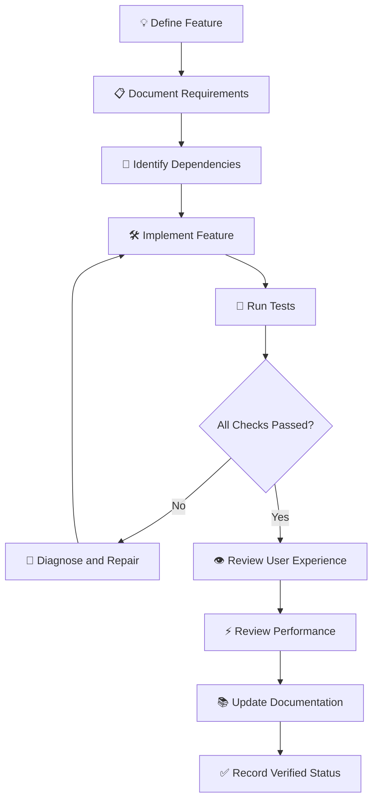

title: "PHOENIX BLAZE | A Conscious Zombie Survival Game"
description: "An HTML5 and Phaser 3 open-world zombie survival sandbox featuring conscious undead, bloodlust management, cannabis-based fictional crafting, stealth, moral choices, and emergent survival gameplay."
keywords: "Phoenix Blaze, conscious zombie game, zombie survival game, HTML5 game, Phaser 3, open world survival, zombie sandbox, survival crafting, bloodlust mechanics, zombie AI, stealth survival, branching narrative, post-apocalyptic game"
project: "Phoenix Blaze"
repository: "https://github.com/reeferguyai/zombie"
developer: "@reeferguyai"
platform: "HTML5"
engine: "Phaser 3"
language: "JavaScript ES6+"
status: "In Development"
license: "Private - All rights reserved"

<div align="center">


# 🧟🔥 PHOENIX BLAZE

### A Conscious Zombie Survival Game

<p>
<strong>RISE FROM THE DEAD. KEEP YOUR HUMANITY. SURVIVE THE APOCALYPSE.</strong>
</p>

<p>
🌋 OPEN WORLD &nbsp;•&nbsp; 🧠 CONSCIOUS UNDEAD &nbsp;•&nbsp; 🍃 SURVIVAL CRAFTING &nbsp;•&nbsp; 🎭 MORAL CHOICES
</p>

<p>


</p>

<p>


</p>

**A WORLD WHERE DEATH IS ONLY THE BEGINNING.**

[🎮 Repository](https://github.com/reeferguyai/zombie) &nbsp;•&nbsp; [📖 Documentation](docs/) &nbsp;•&nbsp; [🤝 Contributing](docs/CONTRIBUTING.md)

<sub>🔥 INFERNO ORANGE &nbsp;•&nbsp; 🩸 BLOOD RED &nbsp;•&nbsp; 🌿 TOXIC GREEN &nbsp;•&nbsp; 🟣 APOCALYPSE PURPLE &nbsp;•&nbsp; ☀️ PHOENIX GOLD</sub>

</div>

---

<div align="center">

## ☣️ PROJECT STATUS & DOCUMENTATION LEGEND

| Indicator | Meaning |
|:---:|---|
|  | Confirmed active work |
|  | Currently being developed |
|  | Intended future work |
|  | Suggested design or architecture |
|  | Requires evaluation |
|  | Not currently prioritized |
|  | Requires implementation or testing confirmation |

</div>

> **DOCUMENTATION RULE:** A proposed feature is not automatically an implemented feature. Status labels describe the documented project state and should be updated only when implementation or verification supports the change.

---

# 📑 TABLE OF CONTENTS

<details open>
<summary><strong>🌋 OPEN THE PHOENIX BLAZE DOCUMENTATION INDEX</strong></summary>

| # | Section | Description |
|---|---|---|
| 01 | [🌋 Overview](#-overview) | Enter the world of Phoenix Blaze |
| 02 | [🎮 Core Features](#-core-features) | Gameplay systems and mechanics |
| 03 | [🧠 Game Identity](#-game-identity) | The world, player, and survival concept |
| 04 | [🏗️ Project Structure](#️-project-structure) | Source code and directory architecture |
| 05 | [⚙️ Technology Stack](#️-technology-stack) | Development technologies |
| 06 | [🚀 Getting Started](#-getting-started) | Installation and setup |
| 07 | [🕹️ Gameplay Systems](#️-gameplay-systems) | Core gameplay architecture |
| 08 | [🗺️ Development Roadmap](#️-development-roadmap) | Four development phases |
| 09 | [🧪 Testing & Quality](#-testing--quality) | Testing and optimization |
| 10 | [🤝 Contributing](#-contributing) | Development participation |
| 11 | [📚 Documentation](#-documentation) | Project documentation |
| 12 | [📖 Glossary](#-glossary) | Game and development terminology |
| 13 | [🔐 License](#-license) | Ownership and licensing |
| 14 | [📡 Contact](#-contact) | Project information |
| 15 | [🌎 World Design & Exploration](#-world-design--exploration) | Regions, locations, environments |
| 16 | [🧟 Zombie Ecology & Intelligence](#-zombie-ecology--intelligence) | Undead classes and behavior |
| 17 | [🏴 Human Factions & Society](#-human-factions--society) | Survivor groups and relationships |
| 18 | [🧬 Character Development](#-character-development) | Attributes, identity, progression |
| 19 | [🎒 Inventory & Equipment](#-inventory--equipment) | Items, storage, loadouts |
| 20 | [🔧 Advanced Crafting](#-advanced-crafting) | Recipes, stations, resources |
| 21 | [🩸 Bloodlust & Humanity](#-bloodlust--humanity) | The central survival mechanic |
| 22 | [🎭 Stealth & Social Infiltration](#-stealth--social-infiltration) | Disguise, suspicion, recognition |
| 23 | [⚔️ Combat & Survival](#️-combat--survival) | Threats, weapons, defense |
| 24 | [🤖 AI & NPC Architecture](#-ai--npc-architecture) | Intelligence, behavior, decisions |
| 25 | [📜 Missions & Narrative](#-missions--narrative) | Quests, stories, consequences |
| 26 | [🏕️ Settlements & Construction](#️-settlements--construction) | Shelters, defenses, communities |
| 27 | [🌦️ Dynamic World Simulation](#️-dynamic-world-simulation) | Weather, time, world state |
| 28 | [🎮 Controls & User Interface](#-controls--user-interface) | HUD, input, interaction |
| 29 | [♿ Accessibility](#-accessibility) | Inclusive gameplay options |
| 30 | [🎵 Audio & Atmosphere](#-audio--atmosphere) | Sound, music, environmental cues |
| 31 | [🎨 Art Direction & Visual Effects](#-art-direction--visual-effects) | Visual identity and presentation |
| 32 | [💾 Save & Persistence Systems](#-save--persistence-systems) | Progress and world continuity |
| 33 | [⚖️ Difficulty & Balancing](#️-difficulty--balancing) | Challenge and progression |
| 34 | [🏗️ Technical Architecture](#️-technical-architecture) | System organization |
| 35 | [🔄 Data Flow & Integration](#-data-flow--integration) | Communication between systems |
| 36 | [🔐 Security & Reliability](#-security--reliability) | Data integrity and safeguards |
| 37 | [⚡ Performance Optimization](#-performance-optimization) | Browser and device performance |
| 38 | [🧪 Advanced Testing Matrix](#-advanced-testing-matrix) | Verification and QA |
| 39 | [🚀 Build & Release Strategy](#-build--release-strategy) | Packaging and deployment |
| 40 | [📊 Feature Status System](#-feature-status-system) | Project tracking conventions |
| 41 | [🛠️ Development Workflow](#️-development-workflow) | Engineering standards |
| 42 | [🗺️ Expanded Milestones](#️-expanded-milestones) | Development targets |
| 43 | [🌌 Future Expansion](#-future-expansion) | Long-term possibilities |
| 44 | [🔎 SEO & Project Metadata](#-seo--project-metadata) | Discoverability and repository presentation |
| 45 | [📋 Feature Acceptance Criteria](#-feature-acceptance-criteria) | Definition of done |
| 46 | [🎮 Gameplay Scenarios](#-gameplay-scenarios) | Example system interactions |
| 47 | [❓ Frequently Asked Questions](#-frequently-asked-questions) | Project reference |
| 48 | [🎨 README Design System](#-readme-design-system) | Styling, badges, and formatting |
| 49 | [📖 Expanded Glossary](#-expanded-glossary) | Additional terminology |
| 50 | [📡 Project Links & Resources](#-project-links--resources) | Repository and documentation links |

</details>

---

<a id="-overview"></a>

# 🌋 OVERVIEW

<p>


</p>

**Phoenix Blaze** is an innovative HTML5-based open-world sandbox survival game where you play as a newly-turned zombie who retains human consciousness.

Manage your bloodlust with cannabis-based crafting, blend in with both humans and zombies, and navigate a post-apocalyptic world of survival, moral choices, and self-discovery.

You aren't just another zombie.

You're something different.

You're caught between two worlds: the instinct to consume and the desire to remain human.

Every decision matters. Every encounter carries consequences. Every survivor has a story.

<details>
<summary>🔥 <strong>THE PHOENIX BLAZE PREMISE</strong></summary>

> <strong>DEATH WAS THE END FOR EVERYONE ELSE. NOT FOR YOU.</strong>

A new existence begins after death.

Your character awakens as a zombie, but something unexpected has happened: your consciousness survived the transformation.

You retain memories, emotions, reasoning, and the ability to make choices.

However, your body has developed instincts that constantly threaten your remaining humanity.

The challenge isn't simply surviving the apocalypse.

It's deciding what kind of creature you will become.

</details>

## 🎯 Core Features

| Feature | Description | Category |
|---|---|---|
| 🧟 **Play as a Conscious Zombie** | Retain fragments of humanity while battling zombie instincts | Character |
| 🍃 **Cannabis Integration** | Craft marijuana-based items to suppress bloodlust and enhance abilities | Crafting |
| 🎭 **Stealth & Disguise** | Blend in with humans or mimic zombie behavior | Stealth |
| 🔨 **Deep Crafting System** | Create tools, weapons, shelters, and survival gear from gathered materials | Survival |
| 🌍 **Open-World Exploration** | Semi-open world with 6-8 diverse regions | Exploration |
| 🤖 **AI-Driven NPCs** | Dynamic interactions with human survivors and other zombies | Intelligence |
| 🎮 **Moral Decision-Making** | Branching storylines based on player choices | Story |
| 🔞 **Mature Content** | NSFW character customization and relationship mechanics | Mature |

## 🌋 The Phoenix Blaze Experience

<details>
<summary>🧠 <strong>WHAT MAKES THIS WORLD DIFFERENT?</strong></summary>

Phoenix Blaze puts the player on the other side of the apocalypse.

Rather than playing as an ordinary human fighting the undead, the player experiences the world through the perspective of an undead character who still possesses human awareness.

This creates unusual gameplay questions:

- Can a zombie be trusted?
- Can humans recognize a conscious undead?
- Can instinct be controlled?
- Can a zombie build relationships?
- Can a monster choose not to become one?
- What happens when different groups discover the truth?

The central conflict is not simply human versus zombie.

It is instinct versus identity.

</details>

### 🎯 Project Design Pillars

| Pillar | Description | Player Impact |
|---|---|---|
| 🧠 Identity | Retaining consciousness after transformation | Personal connection |
| 🩸 Instinct | Managing hunger and bloodlust | Constant pressure |
| 🍃 Adaptation | Using fictional crafting systems to survive | Strategic variety |
| 🎭 Deception | Moving between human and zombie populations | Social tension |
| 🌍 Exploration | Discovering a changing world | Discovery |
| ⚖️ Consequence | Decisions influence relationships and events | Replayability |
| 🔥 Rebirth | Creating a future after civilization falls | Narrative purpose |

---

<a id="-core-features"></a>

# 🎮 CORE FEATURES

<p>


</p>

The following feature descriptions preserve the original core concept while organizing the experience into more detailed gameplay categories.

| Feature | Description | Category |
|---|---|---|
| 🧟 **Play as a Conscious Zombie** | Retain fragments of humanity while battling zombie instincts | Character |
| 🍃 **Cannabis Integration** | Craft marijuana-based items to suppress bloodlust and enhance abilities | Crafting |
| 🎭 **Stealth & Disguise** | Blend in with humans or mimic zombie behavior | Stealth |
| 🔨 **Deep Crafting System** | Create tools, weapons, shelters, and survival gear from gathered materials | Survival |
| 🌍 **Open-World Exploration** | Semi-open world with 6-8 diverse regions | Exploration |
| 🤖 **AI-Driven NPCs** | Dynamic interactions with human survivors and other zombies | Intelligence |
| 🎮 **Moral Decision-Making** | Branching storylines based on player choices | Story |
| 🔞 **Mature Content** | NSFW character customization and relationship mechanics | Mature |

## 🌟 Expanded Feature Categories

| Category | Potential Capabilities |
|---|---|
| 🧟 Character | Identity, appearance, transformation, progression |
| 🩸 Survival | Bloodlust, health, stamina, hunger, environmental threats |
| 🍃 Crafting | Recipes, materials, fictional consumables, workstations |
| 🎭 Social | Disguise, suspicion, trust, reputation |
| 🤖 Intelligence | NPC behavior, enemy perception, decision-making |
| 🌎 Exploration | Regions, points of interest, secrets, safe zones |
| ⚔️ Combat | Melee, ranged encounters, defense, escape |
| 🏕️ Construction | Shelters, storage, defenses, settlement improvements |
| 📜 Narrative | Missions, branching dialogue, consequences |
| 🎨 Presentation | Animation, audio, interface, effects |

---

<a id="-game-identity"></a>

# 🧠 GAME IDENTITY

<p>


</p>

<details>
<summary>🧟 <strong>THE PLAYER: HUMANITY INSIDE THE UNDEAD</strong></summary>

The player character occupies a unique position in the post-apocalyptic world.

**Human characteristics:**
- Memories and identity.
- Reasoning and decision-making.
- Emotional responses.
- Social interaction.
- Moral judgment.

**Zombie characteristics:**
- Bloodlust and hunger.
- Physical deterioration.
- Instinctive behavior.
- Hostile zombie encounters.
- Survival-driven abilities.

The tension between these characteristics creates the central gameplay experience.

</details>

<details>
<summary>🍃 <strong>CANNABIS-BASED SURVIVAL CRAFTING</strong></summary>

Cannabis integration is a distinctive gameplay mechanic.

It provides a crafting and progression system involving fictional consumables, recipes, and survival applications.

Potential mechanics include:

- Bloodlust management.
- Temporary ability enhancements.
- Craftable calming items.
- Resource gathering.
- Recipe discovery.
- Character progression.

</details>

<details>
<summary>🎭 <strong>STEALTH, DISGUISE & SOCIAL SURVIVAL</strong></summary>

The player must navigate encounters with two fundamentally different populations.

**Human survivors**
- Suspicion and trust.
- Social interactions.
- Disguise recognition.
- Reputation and consequences.

**Zombie populations**
- Behavioral mimicry.
- Threat detection.
- Hostile encounters.
- Environmental awareness.

</details>

## 🧬 The Three Dimensions of Player Identity

| Dimension | Description | Gameplay Connection |
|---|---|---|
| 🧠 Humanity | Memory, reasoning, empathy, personality | Dialogue and choices |
| 🧟 Undeath | Instinct, hunger, deterioration, unusual abilities | Survival and bloodlust |
| 🔥 Identity | The character's developing sense of self | Progression and narrative |

### ⚖️ The Central Conflict

> **YOUR BODY REMEMBERS THE HUNGER. YOUR MIND REMEMBERS WHO YOU WERE.**

The player is constantly negotiating between what their body wants and what their mind chooses.

This creates the opportunity for a character system where actions, habits, relationships, and decisions influence the character's evolving identity.

---

<div align="center">

[⬆️ BACK TO TOP](#-phoenix-blaze) &nbsp;•&nbsp; **PART 1 COMPLETE** &nbsp;•&nbsp; [CONTINUE TO PART 2](#️-project-structure)

</div>


---

<div align="center">

# 🏴 HUMAN FACTIONS & SOCIETY

### ⚔️ TRUST IS RARE. POWER IS FRAGILE. SURVIVAL HAS A PRICE.

**THE APOCALYPSE DIDN'T END HUMAN SOCIETY. IT CHANGED THE RULES.**

`FACTIONS` • `REPUTATION` • `DIPLOMACY` • `TERRITORY` • `CONSEQUENCES`

</div>

Human groups should have different motivations, structures, and attitudes toward the undead.

The player must navigate a fractured society where cooperation, suspicion, desperation, and competing philosophies influence survival.

## 🏴 Potential Faction Archetypes

| Faction | Philosophy | Possible Role |
|---|---|---|
| 🏕️ Settlers | Community and stability | Settlement building |
| 🔧 Scavengers | Resource acquisition | Trading and exploration |
| 🛡️ Wardens | Order and protection | Security and patrols |
| 🌑 Outcasts | Independence | Unpredictable encounters |
| 🧪 Remnants | Knowledge and preservation | Research and technology |
| ⚔️ Raiders | Power and control | Hostile encounters |

## 🤝 Relationship Variables

Faction relationships can be influenced by player behavior, dialogue, mission outcomes, and regional events.

| Variable | Gameplay Meaning |
|---|---|
| 🤝 Trust | Confidence in the player |
| ⭐ Reputation | General standing within a group |
| 🛡️ Loyalty | Commitment to an alliance |
| 👁️ Suspicion | Belief that the player is hiding something |
| ⚔️ Hostility | Willingness to oppose the player |
| 🫱 Cooperation | Readiness to provide assistance |
| 💰 Trade Access | Availability of faction resources |
| 🏕️ Territory Access | Permission to enter controlled locations |

## ⚖️ Faction Consequences

Player decisions could affect:

- Available missions.
- Access to safe zones.
- Trading opportunities.
- NPC dialogue.
- Assistance during encounters.
- Faction hostility.
- Regional control.

<details>
<summary>🔥 <strong>FACTION DESIGN EXPANSION</strong></summary>

Each faction can have:

- A leader.
- A history.
- A primary settlement.
- A resource strategy.
- A political philosophy.
- A relationship with other factions.
- A view of conscious zombies.
- A set of missions.
- A reputation threshold for access.

### 🧠 Advanced Faction Possibilities

- Internal disagreements.
- Leadership changes.
- Territorial disputes.
- Resource shortages.
- Temporary alliances.
- Betrayal and reconciliation.
- Faction-specific storylines.
- Dynamic relationships with the player.

</details>

> 🔥 **DESIGN PRINCIPLE:** A faction should remember what the player does. Actions should create consequences that can be felt throughout the world.

---

<div align="center">

# 🧬 CHARACTER DEVELOPMENT

### YOUR BODY CHANGED. YOUR IDENTITY IS STILL YOURS TO DEFINE.

`ATTRIBUTES` • `PROGRESSION` • `SKILLS` • `IDENTITY` • `SPECIALIZATION`

</div>

The player's character should evolve through actions, decisions, and survival experience.

Character development should connect physical abilities, intelligence, social interaction, survival knowledge, and the struggle between humanity and undeath.

## 📊 Potential Character Attributes

| Attribute | Gameplay Influence |
|---|---|
| 💪 Strength | Physical actions and carrying capacity |
| 🫀 Endurance | Stamina and sustained activity |
| 🏃 Agility | Movement and evasive actions |
| 👁️ Awareness | Detection and observation |
| 🧠 Intelligence | Technical and crafting opportunities |
| 🩹 Medical Knowledge | Medical and treatment abilities |
| 🌿 Survival Knowledge | Resource and environmental skills |
| 💬 Social Ability | Negotiation and relationships |

## 🌱 Progression Paths

| Path | Focus |
|---|---|
| 🧟 Undead Survivor | Bloodlust management and zombie abilities |
| 🛠️ Engineer | Construction, repairs, and machinery |
| 🩹 Medic | Medical resources and survivor care |
| 🏹 Hunter | Tracking, stealth, and combat |
| 🌎 Explorer | Discovery and navigation |
| 🤝 Diplomat | Relationships and negotiation |

These are possible progression directions rather than mandatory character classes.

## 🔥 Character Progression Concepts

Potential progression mechanics:

- Experience earned through activities.
- Skill development through repeated actions.
- Unlockable abilities.
- Character traits.
- Reputation-based opportunities.
- Unique zombie abilities.
- Humanity-related decisions.
- Specialized crafting knowledge.

> 🧠 **DESIGN NOTE:** Progression should reward different playstyles. Players should be able to develop a character around exploration, diplomacy, crafting, stealth, combat, or a combination of approaches.

---

<div align="center">

# 🎒 INVENTORY & EQUIPMENT

### EVERY ITEM HAS VALUE. EVERY SLOT IS A DECISION.

`COLLECTION` • `STORAGE` • `EQUIPMENT` • `CONDITION` • `LOADOUTS`

</div>

Inventory management should make preparation and resource decisions meaningful.

The inventory system should support exploration, crafting, equipment management, resource collection, and survival planning.

## 📦 Item Categories

| Category | Examples |
|---|---|
| 🩹 Medical | Bandages, medicine, medical kits |
| 🥫 Food | Canned goods, ingredients, preserved food |
| 💧 Water | Bottles, containers, purification items |
| 🔧 Tools | Hammers, wrenches, cutting tools |
| ⚔️ Weapons | Melee and ranged equipment |
| 🔋 Electronics | Batteries, radios, components |
| 🪵 Materials | Wood, metal, fabric, components |
| 👕 Clothing | Protective and environmental clothing |
| 📜 Documents | Maps, notes, keys, records |

## 🎒 Inventory Capabilities

Potential functionality:

- Item stacking.
- Weight limits.
- Equipment slots.
- Quick-access slots.
- Item durability.
- Item condition.
- Sorting and filtering.
- Search.
- Storage containers.
- Item inspection.
- Context-sensitive actions.

## 🧰 Equipment Loadouts

Possible player loadouts:

| Loadout | Primary Purpose |
|---|---|
| 🧭 Exploration | General travel and discovery |
| 🔎 Scavenging | Resource collection |
| ⚔️ Combat | Defensive and offensive equipment |
| 🩹 Medical Support | Medical supplies and treatment |
| 🏗️ Construction | Building and repair materials |
| 🏕️ Long-Distance Travel | Extended survival preparation |

## 🔄 Inventory Interaction Flow

```text
DISCOVER ITEM
      |
      v
INSPECT ITEM
      |
      v
CHECK INVENTORY SPACE
      |
      v
COLLECT OR STORE
      |
      v
UPDATE ITEM STATE
      |
      v
EQUIP / CRAFT / TRADE / USE
```

> 🎒 **SURVIVAL TIP:** Carrying everything isn't always the best strategy. The right equipment for the situation can be more valuable than a packed inventory.

---

<div align="center">

# 🔧 ADVANCED CRAFTING

### THE WORLD PROVIDES THE MATERIALS. YOUR IMAGINATION PROVIDES THE SOLUTIONS.

`RESOURCES` • `RECIPES` • `WORKSTATIONS` • `EXPERIMENTATION` • `PROGRESSION`

</div>

Crafting connects exploration, resource collection, survival, and progression.

The system can develop from basic resource combinations into a deeper network of recipes, workstations, item quality, and specialized production.

## 🧪 Resource Categories

| Resource | Potential Uses |
|---|---|
| 🪵 Wood | Construction and crafting |
| 🔩 Metal | Tools, repairs, equipment |
| 🧵 Fabric | Clothing and utility items |
| 🔋 Electronics | Devices and equipment |
| 🩹 Medical Materials | Fictional treatment items |
| 🍃 Plant Materials | Fictional cannabis-based crafting |
| 🥫 Food Ingredients | Food preparation |
| 💧 Water | Survival and recipes |
| ⛽ Fuel | Power and machinery |

## 🛠️ Crafting Stations

| Station | Function |
|---|---|
| 🔨 Workbench | General crafting |
| 🩹 Medical Station | Medical items |
| 🍳 Kitchen | Food preparation |
| ⚙️ Workshop | Repairs |
| 🔌 Generator | Power-related systems |
| 📦 Storage Station | Resource organization |

## 🔄 Crafting Workflow

```text
       🔍 DISCOVER RECIPE
               |
               v
       📦 COLLECT MATERIALS
               |
               v
       📋 CHECK REQUIREMENTS
               |
               v
       🛠️ SELECT CRAFTING STATION
               |
               v
       ⚙️ COMPLETE CRAFTING ACTION
               |
               v
       🎁 GENERATE ITEM
               |
               v
       🎒 UPDATE INVENTORY
```

## 🍃 Cannabis-Based Fictional Crafting

The original cannabis integration concept can be expanded into a fictional recipe and progression system.

Potential mechanics:

- Recipe discovery.
- Resource collection.
- Crafting quality.
- Temporary fictional effects.
- Bloodlust suppression.
- Character progression.
- Item condition.
- Recipe experimentation.

### 🌿 Crafting Progression Concepts

| Progression Element | Possible Function |
|---|---|
| 📖 Recipe Knowledge | Unlock new crafting options |
| 🧪 Experimentation | Discover alternative combinations |
| ⭐ Crafting Skill | Improve item quality |
| 🛠️ Workstation Level | Access advanced recipes |
| 📦 Resource Quality | Influence crafting results |
| 🔓 Specialization | Unlock unique crafting branches |

> 🔧 **DESIGN PRINCIPLE:** Crafting should reward exploration, experimentation, resource management, and player creativity.

---

<div align="center">

# 🩸 BLOODLUST & HUMANITY

### THE BODY HUNGERS. THE MIND REMEMBERS.

<sub>THE CENTRAL SURVIVAL CONFLICT OF PHOENIX BLAZE</sub>

`INSTINCT` • `SELF-CONTROL` • `IDENTITY` • `CONSEQUENCES`

</div>

<sub>CORE GAMEPLAY CONCEPT</sub>

Bloodlust is one of the defining mechanics of Phoenix Blaze.

The character retains human consciousness but must contend with instincts associated with undeath.

The challenge is not simply managing a meter. It is balancing survival instincts against the character's remaining identity.

## 🩸 Potential Bloodlust States

| State | Character Condition | Possible Gameplay Effect |
|---|---|---|
| 🟢 Controlled | Instincts manageable | Normal decision-making |
| 🟡 Restless | Hunger increasing | Additional pressure |
| 🟠 Agitated | Instincts becoming difficult | Reduced control opportunities |
| 🔴 Frenzied | Severe bloodlust | Risky or involuntary actions |
| 🔵 Recovering | Instincts stabilizing | Gradual return to control |

These states are conceptual and require balancing and implementation.

## 🧠 Humanity Variables

Potential measurements:

- Empathy.
- Self-control.
- Memory.
- Trust.
- Social connection.
- Moral decisions.
- Instinct management.

## ⚖️ Gameplay Consequences

Bloodlust could influence:

- Dialogue availability.
- Stealth effectiveness.
- NPC suspicion.
- Character behavior.
- Mission outcomes.
- Relationship development.
- Certain progression paths.

## 🍃 Suppression Mechanics

Fictional crafting and consumable systems may provide temporary opportunities to manage bloodlust.

The goal is to create strategic choices rather than a single automatic solution.

## 🔄 Bloodlust Gameplay Loop

```text
       🧟 SURVIVAL ACTIVITY
                |
                v
       🩸 BLOODLUST CHANGES
                |
                v
       🧠 PLAYER EVALUATES STATE
                |
                v
       ⚖️ MAKE A DECISION
                |
       +--------+--------+
       |                 |
       v                 v
  🍃 MANAGE          ⚔️ RISK
  INSTINCTS          LOSING CONTROL
       |                 |
       v                 v
  🟢 RECOVERY       🔴 CONSEQUENCES
       |                 |
       +--------+--------+
                |
                v
       🔥 CHARACTER DEVELOPMENT
```

> 🩸 **THE CORE QUESTION:** How much of yourself can you hold onto when your own instincts are fighting against you?

---

<div align="center">

# 🎭 STEALTH & SOCIAL INFILTRATION

### BLEND IN. STAY QUIET. NEVER LET THEM SEE WHAT YOU REALLY ARE.

`DISGUISE` • `MIMICRY` • `SUSPICION` • `RECOGNITION` • `DECEPTION`

</div>

The player's identity creates unusual opportunities for stealth and deception.

Unlike conventional survival games, Phoenix Blaze can challenge the player to navigate two different populations: humans who fear the undead and zombies who may not recognize the player as one of their own.

## 👁️ Human Suspicion System

Potential suspicion factors:

| Factor | Possible Influence |
|---|---|
| 👤 Appearance | Visual recognition |
| 🚶 Movement | Unusual behavior |
| 💬 Dialogue | Inconsistent responses |
| 🩸 Bloodlust | Instinctive behavior |
| ⚠️ Actions | Suspicious activity |
| ⭐ Reputation | Existing knowledge about the player |

## 🧟 Zombie Mimicry

Potential mechanics:

- Mimic idle behavior.
- Move with zombie groups.
- Avoid attracting attention.
- Observe hostile populations.
- Use environmental concealment.

## 🎯 Stealth Outcomes

| Outcome | Description |
|---|---|
| 🟢 Undetected | Player passes without recognition |
| 🟡 Suspicion | An NPC notices unusual behavior |
| 🟠 Investigation | An NPC actively investigates |
| 🔴 Exposure | Player identity is discovered |
| ⚔️ Hostile Encounter | NPCs respond aggressively |
| 🏃 Escape | Player breaks contact |

## 🧠 Stealth Design Considerations

- Suspicion should develop through understandable events.
- NPC recognition should not be arbitrary.
- Disguise effectiveness should have limits.
- Environmental conditions may influence detection.
- Player actions should influence future encounters.
- Failed stealth should create meaningful consequences.

> 🎭 **DESIGN PRINCIPLE:** The best disguise is not just what the player looks like. It is how convincingly the player behaves.

---

<div align="center">

# ⚔️ COMBAT & SURVIVAL

### FIGHT, HIDE, ESCAPE, OR FIND ANOTHER WAY.

`TACTICS` • `DEFENSE` • `THREATS` • `EQUIPMENT` • `SURVIVAL`

</div>

Combat is one option among several approaches to surviving the world.

Players should have meaningful alternatives to direct confrontation, including stealth, distraction, escape, environmental tactics, and defensive positioning.

## ⚔️ Potential Combat Categories

| Category | Description |
|---|---|
| 🥊 Melee | Close-range encounters |
| 🎯 Ranged | Distance-based combat |
| 🛡️ Defensive | Blocking and evasion |
| 🌎 Environmental | Using surroundings |
| 🏃 Escape | Breaking contact |
| 🎭 Stealth | Avoiding direct confrontation |

## 🛡️ Survival Equipment

- Protective clothing.
- Tools.
- Weapons.
- Medical supplies.
- Storage equipment.
- Navigation equipment.
- Communication devices.

## 🧠 Tactical Choices

Players may:

1. Avoid a threat.
2. Distract it.
3. Find another route.
4. Hide.
5. Defend a position.
6. Fight.
7. Escape.

## ⚖️ Combat Design Goals

| Goal | Intended Result |
|---|---|
| 🎯 Readable Feedback | Players understand what is happening |
| ⚖️ Fair Encounters | Threats follow understandable rules |
| 🧠 Tactical Variety | Multiple solutions to dangerous situations |
| 🛠️ Equipment Relevance | Preparation influences outcomes |
| 🔥 Meaningful Risk | Combat has consequences |
| 🏃 Escape Options | Players are not forced to fight every threat |

---

<div align="center">

# 🤖 AI & NPC ARCHITECTURE

### THE WORLD DOESN'T WAIT FOR THE PLAYER. IT REACTS.

`PERCEPTION` • `DECISION-MAKING` • `BEHAVIOR` • `INTERACTION` • `ADAPTATION`

</div>

AI should make the world feel responsive without making encounters unfair.

Different NPC categories should have behavior appropriate to their roles, capabilities, environments, and relationships with the player.

## 🧠 AI Categories

| AI System | Responsibility |
|---|---|
| 🧟 Zombie AI | Threat detection and behavior |
| 🧍 Survivor AI | Human behavior and decisions |
| 🏴 Faction AI | Patrols and territory |
| 🐾 Wildlife AI | Environmental behavior |
| 💬 Dialogue AI | Conversation responses |
| 🎬 Event Director | Optional encounter pacing |

## 🔄 Behavior Architecture

```text
       👁️ PERCEPTION
              |
              v
       🌎 WORLD OBSERVATION
              |
              v
       🧠 DECISION SYSTEM
              |
              v
       🎯 BEHAVIOR SELECTION
              |
              v
       ⚙️ ACTION EXECUTION
              |
              v
       🔄 WORLD STATE UPDATE
```

## 🤝 NPC Interaction Capabilities

Potential NPC behavior:

- Greeting.
- Conversation.
- Trading.
- Negotiation.
- Requests for assistance.
- Fear and suspicion.
- Trust development.
- Relationship changes.
- Mission participation.

## 🎯 AI Design Requirements

- Respect line-of-sight.
- Respect movement constraints.
- Handle interrupted actions.
- Avoid impossible detection.
- Provide readable feedback.
- Scale behavior according to difficulty.
- Keep AI processing efficient.

### 🧩 AI Architecture Considerations

| Component | Responsibility |
|---|---|
| Perception | Detect relevant world information |
| Memory | Track recent events and interactions |
| Decision Logic | Evaluate available actions |
| Behavior State | Maintain current behavior |
| Navigation | Move through the environment |
| Interaction | Communicate with other entities |
| Event Response | React to changes in world state |

> 🤖 **DESIGN PRINCIPLE:** Intelligent behavior should make the world more believable, not merely make enemies harder to defeat.

---

<div align="center">

# 📜 MISSIONS & NARRATIVE

### EVERY CHOICE LEAVES A MARK. EVERY STORY HAS CONSEQUENCES.

`QUESTS` • `BRANCHING STORIES` • `DECISIONS` • `REWARDS` • `WORLD STATE`

</div>

The narrative should combine authored stories with choices that influence the world.

Mission design can connect exploration, factions, crafting, combat, relationships, and the central conflict between humanity and undeath.

## 📜 Mission Categories

| Mission | Example |
|---|---|
| 🔍 Investigation | Discover what happened at a location |
| 🧰 Recovery | Locate missing supplies |
| 🆘 Rescue | Find a missing survivor |
| 🛡️ Defense | Protect a settlement |
| 🗺️ Exploration | Investigate an unknown region |
| 🔧 Construction | Restore a damaged facility |
| 🤝 Diplomacy | Resolve a faction conflict |
| 🧟 Survival | Survive a dangerous event |

## 🔄 Mission Lifecycle

```text
       📜 AVAILABLE
             |
             v
       🟢 ACCEPTED
             |
             v
       ⚙️ IN PROGRESS
             |
       +-----+------+
       |            |
       v            v
   ❌ FAILED    🎯 OBJECTIVES
                   COMPLETED
                       |
                       v
                🎁 REWARD /
                CONSEQUENCE
                       |
                       v
                  📁 ARCHIVED
```

## 🎭 Narrative Consequences

Potential consequences:

- Different dialogue.
- New missions.
- Lost opportunities.
- Relationship changes.
- Faction hostility.
- Settlement changes.
- Alternative endings.

## 🧠 Narrative Design Opportunities

- Decisions that influence later missions.
- Characters who remember previous encounters.
- Missions with multiple solutions.
- Conflicting faction objectives.
- Hidden information and discoveries.
- Optional storylines.
- Consequences that emerge over time.
- Endings influenced by player identity and choices.

> 📜 **STORY PHILOSOPHY:** The player should not simply watch the apocalypse unfold. The player should influence what comes after it.

---

<div align="center">

# 🏕️ SETTLEMENTS & CONSTRUCTION

### BUILD SOMETHING WORTH PROTECTING.

`SHELTER` • `DEFENSE` • `COMMUNITY` • `RESOURCES` • `INFRASTRUCTURE`

</div>

A future settlement system could let players influence the physical and social environment.

Settlements could become places for recovery, crafting, trade, defense, relationships, and long-term progression.

## 🏗️ Construction Categories

| Category | Potential Structures |
|---|---|
| 🏠 Shelter | Safe houses and sleeping areas |
| 📦 Storage | Containers and resource depots |
| 🛡️ Defense | Barriers and protective structures |
| 🔌 Utilities | Generators and water systems |
| ⚙️ Production | Workbenches and crafting stations |
| 🤝 Community | Shared facilities |
| 🩹 Medical | Treatment areas |

## 🏡 Settlement Variables

- Structural condition.
- Available supplies.
- Security.
- Population.
- Morale.
- Power.
- Water.
- Threat exposure.

## 🔨 Potential Settlement Activities

- Repair damaged structures.
- Improve defenses.
- Organize storage.
- Restore utilities.
- Establish crafting areas.
- Support residents.
- Manage resources.
- Respond to external threats.

> 🏕️ **DESIGN PRINCIPLE:** A settlement should feel like a living place with needs, problems, people, and opportunities.

---

<div align="center">

# 🌦️ DYNAMIC WORLD SIMULATION

### THE WORLD KEEPS MOVING, EVEN WHEN YOU AREN'T LOOKING.

`TIME` • `WEATHER` • `ENVIRONMENT` • `WORLD EVENTS` • `REGIONAL CONDITIONS`

</div>

The world should feel active beyond the player's immediate location.

Environmental conditions and world events can create changing opportunities, risks, and challenges.

## 🌤️ Environmental Systems

Potential features:

- Day and night cycles.
- Weather.
- Rain and storms.
- Fog.
- Visibility.
- Environmental decay.
- Power availability.
- Water availability.
- Regional threat levels.

## 🕒 Time-Based Opportunities

Possible world events may vary based on:

- Time of day.
- Weather.
- Location.
- Previous player actions.
- Faction activity.
- World progression.

## 🌎 Dynamic World Possibilities

| System | Potential World Effect |
|---|---|
| 🌅 Day/Night | Changes visibility and NPC behavior |
| 🌧️ Weather | Influences travel and environmental conditions |
| 🌫️ Fog | Alters visibility and detection |
| 🔌 Power | Changes facility availability |
| 🧟 Threat Levels | Influences dangerous encounters |
| 🏴 Faction Activity | Changes regional control |
| 📜 World Events | Introduces evolving situations |

> 🌦️ **DESIGN PRINCIPLE:** The world should feel like a place that exists independently of the player's immediate actions.

---

<div align="center">

## 🔥 END OF PART 2

**PHOENIX BLAZE**

*Rise from the dead. Keep your humanity. Survive the apocalypse.*

### 🧟 THE STORY CONTINUES...

</div>


---

<div align="center">

# 🎮 CONTROLS & USER INTERFACE

### EVERY ACTION SHOULD FEEL RESPONSIVE. EVERY DECISION SHOULD FEEL CLEAR.

`INPUT` • `HUD` • `NAVIGATION` • `INTERACTION` • `FEEDBACK`

</div>

The interface should communicate useful information without overwhelming the player.

The user experience should support exploration, survival, combat, crafting, character development, and interaction with the world.

## 🖥️ Potential HUD Components

| Element | Purpose |
|---|---|
| ❤️ Health | Player condition |
| 🩸 Bloodlust | Instinct management |
| ⚡ Stamina | Physical exertion |
| 🧭 Compass | Direction |
| 📜 Objectives | Active missions |
| 🎒 Inventory | Item management |
| 👁️ Threat Indicator | Relevant danger |
| 💧 Resources | Essential survival supplies |

## 🕹️ Input Support

Potential control methods:

- Keyboard.
- Mouse.
- Touchscreen.
- Optional game controller.

## 🧩 UI Interaction States

Every interactive element should consider:

| State | Expected Behavior |
|---|---|
| Default | Normal appearance |
| Hover | Visual hover feedback |
| Focus | Keyboard-accessible focus indication |
| Active | Interaction is occurring |
| Disabled | Action is unavailable |
| Loading | Operation is processing |
| Success | Action completed successfully |
| Error | Clear explanation of failure |

## 🧭 Interface Design Principles

- Keep essential survival information accessible.
- Avoid unnecessary screen clutter.
- Use consistent interaction patterns.
- Make important actions easy to discover.
- Provide readable feedback for player actions.
- Support keyboard and pointer navigation.
- Keep interface behavior consistent across game screens.

> 🎮 **DESIGN PRINCIPLE:** The interface should help players understand the world, not compete with it for attention.

---

<div align="center">

# ♿ ACCESSIBILITY

### SURVIVAL SHOULD BE ABOUT THE GAME, NOT FIGHTING THE INTERFACE.

`READABILITY` • `INPUT OPTIONS` • `AUDIO ACCESS` • `MOTION` • `CUSTOMIZATION`

</div>

Accessibility should be part of the design process from the beginning.

The game should provide practical options that allow different players to interact comfortably with its systems.

## 🌈 Potential Accessibility Features

| Feature | Purpose |
|---|---|
| 🔠 Text Scaling | Readability |
| 💬 Subtitle Controls | Dialogue access |
| 🌓 High Contrast | Visual clarity |
| 🎨 Color Alternatives | Color-vision accessibility |
| 🧘 Reduced Motion | Animation comfort |
| 🔊 Independent Audio Controls | Sound customization |
| 🎮 Input Remapping | Control flexibility |
| ⚖️ Difficulty Options | Adjustable challenge |

## 🧠 Additional Accessibility Considerations

- Clear menu navigation.
- Consistent button labels.
- Readable typography.
- Avoid relying on color alone.
- Adjustable camera sensitivity.
- Configurable screen shake.
- Optional tutorial assistance.
- Clear warnings before destructive actions.
- Keyboard-accessible menus.
- Appropriate feedback for important events.

## ⚙️ Accessibility Configuration

Potential settings categories:

| Category | Example Options |
|---|---|
| Visual | Text size, contrast, interface scale |
| Audio | Subtitles, dialogue volume, sound indicators |
| Motion | Reduced animation, camera shake |
| Controls | Remapping, sensitivity |
| Gameplay | Difficulty adjustments, tutorial support |

> ♿ **DESIGN PRINCIPLE:** Accessibility options should be discoverable, understandable, and available without unnecessary barriers.

---

<div align="center">

# 🎵 AUDIO & ATMOSPHERE

### HEAR THE WORLD BEFORE YOU SEE IT.

`AMBIENCE` • `SOUND EFFECTS` • `MUSIC` • `DIALOGUE` • `ATMOSPHERE`

</div>

Audio should communicate danger, location, and mood.

Sound can provide important information about the environment, nearby threats, NPC activity, and player actions.

## 🔊 Audio Categories

- Environmental ambience.
- Weather.
- Footsteps.
- Object interactions.
- Zombie sounds.
- Human dialogue.
- Radio broadcasts.
- Music.
- Interface feedback.

## 🎧 Audio Settings

Potential independent controls:

| Setting | Function |
|---|---|
| 🔊 Master Volume | Overall audio level |
| 🎵 Music | Background music |
| 💥 Sound Effects | Gameplay sound effects |
| 💬 Dialogue | Character voices |
| 🌲 Ambient Audio | Environmental sounds |

## 🌎 Environmental Audio Opportunities

Potential audio systems:

- Distant environmental activity.
- Indoor and outdoor acoustic differences.
- Weather-dependent ambience.
- Footstep surfaces.
- Nearby NPC conversations.
- Directional threat cues.
- Radio transmissions.
- Location-specific soundscapes.

## 🧟 Audio Feedback

Important events should have recognizable audio feedback where appropriate.

Examples:

- Inventory interactions.
- Crafting completion.
- Mission updates.
- Threat detection.
- Bloodlust state changes.
- Environmental warnings.
- Player damage.

> 🎧 **ATMOSPHERE GOAL:** The world should sound inhabited, dangerous, unpredictable, and occasionally peaceful.

---

<div align="center">

# 🎨 ART DIRECTION & VISUAL EFFECTS

### A BROKEN WORLD. A DISTINCT IDENTITY. A SPARK THAT REFUSES TO DIE.

`VISUAL IDENTITY` • `LIGHTING` • `PARTICLES` • `ANIMATION` • `ENVIRONMENT`

</div>

The Phoenix Blaze visual identity should combine decay, danger, supernatural elements, and flashes of hope.

The art direction should reinforce the game's themes while maintaining gameplay clarity and performance.

## 🔥 Visual Effects

- Fire and embers.
- Smoke.
- Fog.
- Rain.
- Dust.
- Environmental particles.
- Lighting transitions.
- Damage effects.
- UI status glows.

## 🎨 Visual Design Principles

| Principle | Application |
|---|---|
| 🔥 Contrast | Make important information readable |
| 🌫️ Atmosphere | Reinforce the post-apocalyptic setting |
| 👁️ Clarity | Keep gameplay feedback understandable |
| 🎭 Consistency | Maintain a recognizable visual identity |
| ⚡ Performance | Scale effects for different devices |

## 🌆 Environmental Art Direction

Potential visual elements:

- Abandoned buildings.
- Damaged infrastructure.
- Overgrown streets.
- Weathered interiors.
- Ruined vehicles.
- Makeshift settlements.
- Forgotten facilities.
- Environmental storytelling.
- Signs of previous human activity.

## ✨ Visual Effects Considerations

| Effect | Possible Application |
|---|---|
| 🔥 Fire | Destruction and environmental hazards |
| 🌫️ Fog | Atmosphere and visibility |
| 🌧️ Rain | Weather and environmental mood |
| 💨 Smoke | Fires, damaged facilities |
| ✨ Particles | Environmental detail |
| 💡 Lighting | Mood and visibility |
| 🩸 UI Effects | Bloodlust and player condition |

> 🎨 **ART DIRECTION:** Visual spectacle should support the experience, not obscure important gameplay information.

---

<div align="center">

# 💾 SAVE & PERSISTENCE SYSTEMS

### YOUR STORY SHOULD SURVIVE THE SESSION.

`SAVE DATA` • `LOAD DATA` • `RECOVERY` • `WORLD STATE` • `CONTINUITY`

</div>

A save system should preserve meaningful player progress.

Save data should account for character development, inventory, missions, relationships, discovered locations, world state, and configuration.

## 📦 Potential Save Data

- Player position.
- Character attributes.
- Inventory.
- Equipment.
- Completed missions.
- Active missions.
- Faction relationships.
- Settlement state.
- Discovered locations.
- World events.
- Game settings.

## 🔄 Save Lifecycle

```text
       🎮 PLAYER ACTION
              |
              v
       🔍 VALIDATE STATE CHANGE
              |
              v
       🔄 UPDATE GAME STATE
              |
              v
       📝 MARK STATE FOR SAVING
              |
              v
       💾 SAVE AT APPROVED POINT
              |
              v
       ✅ CONFIRM SAVE RESULT
```

## 🗃️ Save System Considerations

| Feature | Purpose |
|---|---|
| 💾 Manual Save | Player-controlled saving |
| 🔄 Automatic Save | Save at appropriate checkpoints |
| 📁 Multiple Slots | Maintain separate playthroughs |
| 🛡️ Validation | Detect invalid or incomplete data |
| ♻️ Recovery | Recover from interrupted saves |
| 📊 Versioning | Support changes to save structure |
| ⚙️ Settings Persistence | Retain player preferences |

## 🔐 Data Integrity

Potential safeguards:

- Validate save data before loading.
- Handle missing or malformed fields.
- Avoid overwriting valid saves with invalid data.
- Provide clear save failure feedback.
- Consider backup copies.
- Support future save-format migrations.

> 💾 **DESIGN PRINCIPLE:** Saving should be dependable, transparent, and resilient to interruptions.

---

<div align="center">

# ⚖️ DIFFICULTY & GAME BALANCING

### THE APOCALYPSE SHOULD CHALLENGE PLAYERS WITHOUT CHEATING THEM.

`DIFFICULTY` • `PROGRESSION` • `THREATS` • `RESOURCES` • `FAIRNESS`

</div>

Game balancing should create meaningful challenges while allowing different approaches to survival.

The difficulty model should account for combat, resource availability, bloodlust, exploration, NPC behavior, and mission consequences.

## 🎚️ Potential Difficulty Categories

| Category | Possible Adjustment |
|---|---|
| 🧟 Zombie Threat | Enemy detection and aggression |
| 🩸 Bloodlust | Instinct pressure and recovery |
| 🥫 Resources | Availability of supplies |
| ⚔️ Combat | Damage and encounter difficulty |
| 🧠 AI | NPC awareness and behavior |
| 🌎 Exploration | Environmental hazards |
| 🩹 Recovery | Availability of recovery resources |

## 📊 Balancing Variables

- Player health.
- Stamina consumption.
- Resource scarcity.
- Item durability.
- Enemy perception.
- Enemy movement.
- Bloodlust progression.
- Crafting requirements.
- Mission rewards.
- Recovery opportunities.

## 🧪 Testing & Balancing Process

```text
       📋 DEFINE DESIGN TARGET
                |
                v
       ⚙️ CONFIGURE PARAMETERS
                |
                v
       🎮 PLAYTEST
                |
                v
       📊 COLLECT RESULTS
                |
                v
       🔍 IDENTIFY PROBLEMS
                |
                v
       🔧 ADJUST BALANCE
                |
                v
       🔁 TEST AGAIN
```

> ⚖️ **BALANCING PRINCIPLE:** Difficulty should come from understandable systems and meaningful decisions, not arbitrary punishment.

---

<div align="center">

# 🏗️ TECHNICAL ARCHITECTURE

### THE ENGINE UNDER THE APOCALYPSE.

`HTML5` • `PHASER 3` • `JAVASCRIPT ES6+` • `GAME SYSTEMS` • `MODULAR DESIGN`

</div>

Phoenix Blaze is designed as an HTML5 game using Phaser 3 and JavaScript ES6+.

The architecture should support maintainable development, modular game systems, reliable state management, and efficient browser performance.

## 🧰 Core Technology Stack

| Technology | Intended Responsibility |
|---|---|
| 🌐 HTML5 | Game delivery platform |
| 🎮 Phaser 3 | Game engine |
| 🟨 JavaScript ES6+ | Application and gameplay logic |
| 📦 Webpack / Parcel | Potential asset bundling |
| 🧪 Jest | Automated testing |
| 🔧 Git | Version control |

## 🧩 Architectural Design Principles

- Modular game systems.
- Separation of concerns.
- Reusable components.
- Centralized configuration.
- Predictable game-state transitions.
- Efficient asset loading.
- Maintainable event handling.
- Testable gameplay logic.
- Graceful error handling.

## 🗂️ Potential System Organization

```text
PHOENIX BLAZE
│
├── CORE ENGINE
│   ├── Game Initialization
│   ├── Configuration
│   ├── Scene Management
│   └── Event Management
│
├── PLAYER SYSTEMS
│   ├── Character Controller
│   ├── Attributes
│   ├── Inventory
│   ├── Equipment
│   └── Bloodlust
│
├── WORLD SYSTEMS
│   ├── World Map
│   ├── Environment
│   ├── Weather
│   ├── Time
│   └── World Events
│
├── NPC SYSTEMS
│   ├── Zombie AI
│   ├── Survivor AI
│   ├── Faction AI
│   └── Dialogue
│
├── GAMEPLAY SYSTEMS
│   ├── Combat
│   ├── Stealth
│   ├── Crafting
│   ├── Missions
│   └── Settlements
│
├── PRESENTATION
│   ├── HUD
│   ├── Menus
│   ├── Audio
│   └── Visual Effects
│
└── PERSISTENCE
    ├── Save Manager
    ├── Load Manager
    ├── Validation
    └── Recovery
```

*This is a proposed logical architecture, not a claim that every listed module already exists in the repository.*

---

<div align="center">

# ⚡ PERFORMANCE & OPTIMIZATION

### MORE WORLD. LESS WAITING.

`FRAME RATE` • `MEMORY` • `ASSETS` • `RENDERING` • `RESPONSIVENESS`

</div>

Performance should be considered throughout development, especially for browser-based gameplay.

## 🚀 Optimization Areas

| Area | Potential Approach |
|---|---|
| 🎨 Rendering | Limit unnecessary redraws |
| 🖼️ Assets | Optimize image dimensions and formats |
| 🔊 Audio | Load and manage audio efficiently |
| 🧠 AI | Avoid unnecessary repeated calculations |
| 📦 Memory | Release unused resources |
| 🗺️ World | Process relevant regions efficiently |
| ⚙️ JavaScript | Reduce expensive operations |
| 🌐 Network | Minimize unnecessary requests |

## 📊 Performance Measurements

Potential metrics:

- Frames per second.
- Frame-time consistency.
- Initial loading time.
- Memory usage.
- Asset loading duration.
- Input responsiveness.
- Scene transition time.
- Runtime errors.

## 🔍 Optimization Workflow

```text
       📊 MEASURE PERFORMANCE
                 |
                 v
       🔍 IDENTIFY BOTTLENECK
                 |
                 v
       🧪 REPRODUCE PROBLEM
                 |
                 v
       🔧 APPLY OPTIMIZATION
                 |
                 v
       📈 MEASURE AGAIN
                 |
                 v
       ✅ VERIFY IMPROVEMENT
```

> ⚡ **PERFORMANCE PRINCIPLE:** Optimize measured bottlenecks rather than guessing where problems exist.

---

<div align="center">

# 🧪 QUALITY ASSURANCE & TESTING

### EVERY SYSTEM MUST EARN ITS PLACE IN THE GAME.

`UNIT TESTS` • `INTEGRATION TESTS` • `PLAYTESTING` • `REGRESSION` • `BUG TRACKING`

</div>

Testing should cover both individual gameplay systems and interactions between them.

## 🧪 Testing Categories

| Test Type | Purpose |
|---|---|
| Unit Testing | Validate individual functions |
| Integration Testing | Validate connected systems |
| Gameplay Testing | Evaluate actual player experience |
| Regression Testing | Detect previously fixed issues |
| Performance Testing | Identify performance problems |
| Compatibility Testing | Check supported browsers and devices |
| Accessibility Testing | Verify accessibility behavior |

## 🔍 Core Gameplay Test Areas

- Character movement.
- Collision detection.
- Inventory operations.
- Crafting.
- Bloodlust state transitions.
- NPC behavior.
- Dialogue.
- Missions.
- Saving and loading.
- Interface interactions.

## 🐛 Bug Reporting Structure

| Field | Description |
|---|---|
| Bug ID | Unique identifier |
| Title | Short issue description |
| Severity | Impact level |
| Reproduction Steps | How to reproduce |
| Expected Result | Intended behavior |
| Actual Result | Observed behavior |
| Environment | Browser and device |
| Status | Current resolution state |

## 🚦 Suggested Severity Levels

| Severity | Meaning |
|---|---|
| 🔴 Critical | Prevents core functionality |
| 🟠 High | Major gameplay or stability issue |
| 🟡 Medium | Noticeable issue with a workaround |
| 🟢 Low | Minor visual or usability issue |

> 🧪 **QUALITY PRINCIPLE:** A feature is not complete simply because it works once. It should work reliably across expected conditions.

---

<div align="center">

# 🌐 BROWSER & DEVICE COMPATIBILITY

### BUILT FOR THE WEB. READY FOR THE PLAYER.

`BROWSERS` • `DEVICES` • `INPUT` • `RESPONSIVENESS`

</div>

Phoenix Blaze should be evaluated across its intended browser and device environments.

## 🌍 Compatibility Considerations

- Browser rendering differences.
- JavaScript feature support.
- Audio playback restrictions.
- Keyboard and pointer input.
- Touchscreen interaction.
- Screen dimensions.
- Device performance.
- Asset loading behavior.
- Storage availability.

## 📱 Responsive Experience

Potential support considerations:

| Environment | Design Focus |
|---|---|
| 🖥️ Desktop | Full interface and keyboard/mouse |
| 💻 Laptop | Responsive interface and performance |
| 📱 Mobile | Touch input and smaller displays |
| 📟 Tablet | Adaptive layout and touch controls |

*Supported browsers and minimum device requirements should be established through actual testing.*

---

<div align="center">

# 🔒 SECURITY & DATA PROTECTION

### PROTECT THE PLAYER. PROTECT THE EXPERIENCE.

`VALIDATION` • `STORAGE` • `ERROR HANDLING` • `DEPENDENCIES`

</div>

Security considerations should be included in the architecture and development process.

## 🛡️ Potential Safeguards

- Validate external input.
- Avoid unsafe HTML injection.
- Protect sensitive information.
- Avoid embedding secrets in client-side code.
- Review third-party dependencies.
- Handle malformed stored data.
- Use secure transport for network features.
- Provide safe error handling.

## 🔍 Security Review Areas

| Area | Review Focus |
|---|---|
| Input | Validation and sanitization |
| Storage | Data integrity |
| Dependencies | Known vulnerabilities |
| Network | Secure communication |
| Errors | Avoid leaking sensitive details |
| Assets | Validate external resources |

> 🔐 **SECURITY PRINCIPLE:** Browser-based applications should never assume that client-side data or logic is automatically trustworthy.

---

<div align="center">

# 🧭 DEVELOPMENT PHILOSOPHY

### BUILD THE FOUNDATION. TEST THE EXPERIENCE. EXPAND THE WORLD.

`MODULARITY` • `RELIABILITY` • `ITERATION` • `PLAYER EXPERIENCE`

</div>

Phoenix Blaze should grow through deliberate development rather than disconnected feature additions.

## 🏗️ Development Priorities

1. Establish a stable playable foundation.
2. Ensure core character movement and interaction work.
3. Build reliable game-state management.
4. Implement the defining bloodlust mechanic.
5. Connect inventory and crafting.
6. Develop NPC behavior and world interaction.
7. Expand narrative and faction systems.
8. Improve presentation and atmosphere.
9. Optimize performance.
10. Validate the complete experience.

## 🔄 Development Cycle

```text
       💡 DESIGN
          |
          v
       🏗️ BUILD
          |
          v
       🧪 TEST
          |
          v
       🔍 REVIEW
          |
          v
       🔧 IMPROVE
          |
          v
       🚀 RELEASE
          |
          +-----------> REPEAT
```

---

<div align="center">

# 🐦‍🔥 END OF PART 3

### PHOENIX BLAZE

**RISE. SURVIVE. REMEMBER WHO YOU WERE.**

*The apocalypse changed the world. It doesn't get to decide who you become.*

</div>

---

---

# 🚀 BUILD & RELEASE STRATEGY

> **MISSION:** Transform the Phoenix Blaze vision into a stable, tested, documented, and maintainable game.

The release strategy separates development into measurable stages. Each stage should have clear objectives, verification requirements, and exit criteria.

## 📦 Release Lifecycle

| Stage | Primary Objective | Exit Criteria |
|---|---|---|
| 🧪 Prototype | Validate core gameplay concepts | Core mechanics can be demonstrated |
| 🏗️ Pre-Alpha | Establish the technical foundation | Essential architecture is operational |
| 🔥 Alpha | Integrate major gameplay systems | Major features are connected |
| 🧰 Beta | Stabilize and balance the experience | Major gameplay paths are testable |
| 🎯 Release Candidate | Verify release readiness | No known release-blocking defects |
| 🌎 Public Release | Deliver an approved version | Release package and documentation are ready |
| 🔄 Post-Release | Maintain and improve the game | Updates are tested and documented |

## ✅ Release Readiness Checklist

### Technical Verification
- [ ] Production build completes successfully.
- [ ] Dependencies are documented.
- [ ] Configuration files are reviewed.
- [ ] No private credentials are included.
- [ ] Critical errors are resolved.
- [ ] Browser console is reviewed.
- [ ] Asset paths are verified.
- [ ] Loading behavior is tested.

### Gameplay Verification
- [ ] Player movement works.
- [ ] Interactions work.
- [ ] Inventory operations are tested.
- [ ] Crafting requirements are validated.
- [ ] Bloodlust behavior is tested.
- [ ] Enemy behavior is reviewed.
- [ ] Mission progression is tested.
- [ ] Save and load behavior is verified.

### Presentation Verification
- [ ] HUD elements display correctly.
- [ ] Menus are navigable.
- [ ] Audio controls work.
- [ ] Visual effects are reviewed.
- [ ] Accessibility options are tested.
- [ ] Mobile layouts are reviewed.

### Documentation Verification
- [ ] README is updated.
- [ ] Installation instructions are accurate.
- [ ] Known issues are documented.
- [ ] Release notes are prepared.
- [ ] License information is accurate.
- [ ] Project links are checked.

---

# 📊 FEATURE STATUS & DEVELOPMENT TRACKING

Every feature should have an honest, traceable status.

A concept described in this README is not automatically an implemented game feature. Status labels help distinguish the vision from verified functionality.

## 🏷️ Official Feature Status Definitions

| Status | Meaning | When to Use |
|---|---|---|
| 💡 `IDEA` | Concept only | Under consideration |
| 📋 `PLANNED` | Approved future work | Accepted into the roadmap |
| 🛠️ `IN_PROGRESS` | Active development | Implementation has started |
| ⚙️ `IMPLEMENTED` | Implementation exists | Code or content is present |
| 🧪 `TESTING` | Under verification | Testing is underway |
| ✅ `VERIFIED` | Acceptance criteria passed | Behavior has been confirmed |
| 🚧 `BLOCKED` | Cannot currently proceed | A dependency or issue prevents progress |
| ⏸️ `DEFERRED` | Postponed | Intentionally moved to a later stage |
| 🧹 `REFACTORING` | Structural improvement | Existing implementation is being improved |

## 🎨 Visual Status Badges

<p align="center">
  
  
  
  
</p>

<p align="center">
  
  
  
  
</p>

> **IMPORTANT:** Only mark a feature `VERIFIED` after its defined acceptance criteria have passed. Never use a badge to imply functionality that has not been tested.

## 🧭 Feature Tracking Template

Use this structure when adding new features to the project documentation.

| Field | Description |
|---|---|
| Feature Name | Name of the system or mechanic |
| Feature ID | Unique tracking identifier |
| Category | Gameplay, AI, UI, world, audio, or technical |
| Status | Current development status |
| Priority | Critical, high, medium, or low |
| Dependencies | Required systems or assets |
| Owner | Assigned developer |
| Acceptance Criteria | Conditions required for completion |
| Test Coverage | Relevant automated and manual tests |
| Documentation | Location of supporting documentation |

---

# 🛠️ DEVELOPMENT WORKFLOW

## 🔄 Recommended Development Cycle



## 📌 Development Rules

1. Understand the existing implementation before changing it.
2. Preserve working functionality.
3. Avoid unnecessary duplication.
4. Keep gameplay systems modular.
5. Validate inputs and state changes.
6. Test affected systems after modifications.
7. Document new dependencies.
8. Keep feature status accurate.
9. Review changes before merging.
10. Maintain a recoverable project history.

## 🌿 Suggested Git Branch Strategy

| Branch | Purpose |
|---|---|
| `main` | Stable project baseline |
| `develop` | Integrated development |
| `feature/*` | Individual feature development |
| `fix/*` | Bug fixes |
| `release/*` | Release preparation |
| `hotfix/*` | Urgent corrections |

## 📝 Commit Message Convention

Use descriptive commit messages that identify the type of change.

```text
feat: add inventory filtering
fix: prevent duplicate item transfers
docs: expand survival mechanics
test: add save validation coverage
perf: reduce unnecessary AI updates
refactor: separate mission state management
style: improve HUD visual consistency
chore: update development dependencies
```

### Commit Categories

| Prefix | Purpose |
|---|---|
| `feat` | New functionality |
| `fix` | Bug correction |
| `docs` | Documentation changes |
| `test` | Testing changes |
| `perf` | Performance improvements |
| `refactor` | Code restructuring |
| `style` | Formatting and presentation |
| `chore` | Maintenance tasks |

---

# 🗺️ EXPANDED DEVELOPMENT MILESTONES

The following milestone structure expands the project's development roadmap into measurable targets.

| Milestone | Development Target | Completion Evidence |
|---|---|---|
| 🔹 M1 | Project Foundation | Project builds and launches |
| 🔹 M2 | Player Controls | Movement and interaction work |
| 🔹 M3 | Survival Systems | Essential survival mechanics function |
| 🔹 M4 | Bloodlust System | Bloodlust states behave correctly |
| 🔹 M5 | Inventory and Crafting | Item management and crafting work |
| 🔹 M6 | Zombie Intelligence | Basic enemy behavior functions |
| 🔹 M7 | World Exploration | Regions and locations are explorable |
| 🔹 M8 | NPCs and Factions | Basic character interactions work |
| 🔹 M9 | Missions and Narrative | Mission progression functions |
| 🔹 M10 | Persistence | Save and load are verified |
| 🔹 M11 | Presentation | UI, audio, and visual effects are integrated |
| 🔹 M12 | Release Readiness | Major defects are addressed |

## 🎯 Milestone Completion Rules

A milestone should not be considered complete merely because its target has been started.

Each milestone should include:

- Defined objectives.
- Required features.
- Dependencies.
- Implementation tasks.
- Testing requirements.
- Known limitations.
- Completion evidence.
- Documentation updates.

---

# 🌌 FUTURE EXPANSION & CONTENT ROADMAP

Phoenix Blaze is designed around a world that can grow over time.

The following ideas represent potential expansions, not promises of currently implemented functionality.

## 🌎 World Expansion Opportunities

- New geographic regions.
- Underground environments.
- Remote settlements.
- Industrial complexes.
- Abandoned research facilities.
- Coastal environments.
- Wilderness territories.
- Quarantined urban districts.
- Hidden underground communities.
- Restricted military installations.

## 🎮 Gameplay Expansion Opportunities

- Companion systems.
- Settlement construction.
- Expanded faction politics.
- Dynamic world events.
- Advanced crafting.
- Vehicle systems.
- Additional survival challenges.
- Expanded character progression.
- More complex stealth mechanics.
- Advanced resource management.

## 🤖 AI & NPC Expansion Opportunities

- More advanced NPC decision-making.
- Persistent character relationships.
- Group behavior and coordination.
- Dynamic faction reactions.
- Memory-driven character interactions.
- Adaptive enemy strategies.
- Environmental awareness.
- More sophisticated perception systems.

## 🧪 Technology Expansion Opportunities

Subject to technical feasibility and project priorities:

- Cooperative multiplayer.
- Dedicated server architecture.
- Cloud save synchronization.
- Mod support.
- Procedural world generation.
- Advanced NPC behavior.
- Cross-platform support.
- Expanded accessibility options.
- Additional input methods.

## 📜 Narrative Expansion Opportunities

- New missions.
- New characters.
- New enemy types.
- New environments.
- New equipment.
- Additional narrative chapters.
- Alternative story outcomes.
- Expanded faction storylines.
- Discoverable historical records.
- Environmental storytelling.

---

# 🔎 SEO & PROJECT METADATA

This section establishes consistent project terminology for repository listings, documentation, search previews, and related project pages.

## 🏷️ Core Project Metadata

| Field | Value |
|---|---|
| Project Name | Phoenix Blaze |
| Full Title | Phoenix Blaze: A Conscious Zombie Survival Game |
| Genre | Open-world sandbox survival |
| Platform | HTML5 |
| Engine | Phaser 3 |
| Language | JavaScript ES6+ |
| Primary Theme | Conscious undead survival |
| Setting | Post-apocalyptic world |
| Repository | `reeferguyai/zombie` |
| Developer | `@reeferguyai` |
| Project Status | In Development |
| License | Private - All rights reserved |

## 🔑 Primary Keyword Library

**Primary keywords**

- Phoenix Blaze.
- Conscious zombie survival game.
- Zombie survival sandbox.
- HTML5 zombie game.
- Phaser 3 survival game.

**Secondary keywords**

- Open-world zombie survival.
- Post-apocalyptic sandbox.
- Zombie character progression.
- Bloodlust management.
- Zombie stealth mechanics.
- Survival crafting.
- Zombie AI.
- Branching survival narrative.

**Long-tail keyword ideas**

- Play as a conscious zombie in a survival game.
- Open-world zombie survival with moral choices.
- Zombie game with crafting and stealth mechanics.
- HTML5 post-apocalyptic survival sandbox.
- Survival game featuring a conscious undead protagonist.

## 🌐 Social Preview Metadata

**Suggested title**

`PHOENIX BLAZE 🧟🔥`

**Suggested description**

Death was supposed to be the end. You have other plans. Explore a post-apocalyptic world as a conscious zombie caught between humanity and instinct.

**Suggested preview artwork**

A conscious zombie character standing between a burning city and a toxic-green wilderness, surrounded by inferno-orange embers and apocalypse-purple atmospheric lighting.

---

# 📋 FEATURE ACCEPTANCE CRITERIA

A feature should not be considered complete simply because code exists.

The implementation must satisfy its expected behavior and pass the appropriate checks.

## ✅ Definition of Done

A feature may be considered complete when:

1. Its intended behavior is documented.
2. Its implementation exists.
3. Required dependencies are present.
4. Relevant automated tests pass.
5. Manual testing has been completed where appropriate.
6. Error handling is implemented.
7. The user experience is reviewed.
8. Performance is acceptable.
9. Documentation is updated.
10. No known critical defect remains.
11. Its development status is recorded accurately.

## 🧪 Example Acceptance Criteria: Bloodlust System

| Requirement | Verification Method |
|---|---|
| Bloodlust value exists | State can be read |
| Bloodlust changes | Valid actions update the value |
| Thresholds work | Expected state transitions occur |
| Suppression works | Approved mechanics affect the value |
| HUD updates | Player receives clear feedback |
| Save integration | State persists when intended |
| Invalid values rejected | State remains within defined bounds |
| Recovery behavior | Invalid state can be handled safely |

## 🎒 Example Acceptance Criteria: Inventory

| Requirement | Verification Method |
|---|---|
| Item collection | Valid items enter inventory |
| Item removal | Selected items are removed |
| Capacity | Inventory limits are respected |
| Equipment | Compatible items can be equipped |
| Stacking | Stack rules are enforced |
| Transfers | Duplicate transfers are prevented |
| Persistence | Inventory state survives saving |
| UI feedback | Changes are reflected correctly |

---

# 🎮 GAMEPLAY SCENARIOS

These scenarios demonstrate how multiple systems could interact during a typical play session.

They are design examples and should not be interpreted as confirmation that every associated feature is implemented.

## 🏥 Scenario A: The Abandoned Pharmacy

**Objective:** Search an abandoned pharmacy for useful supplies.

1. Discover the pharmacy.
2. Observe the building and surrounding area.
3. Listen for nearby threats.
4. Select an entry route.
5. Search accessible areas.
6. Discover a locked medical cabinet.
7. Locate a key or alternative access method.
8. Collect available supplies.
9. Manage inventory capacity.
10. Leave before attracting additional threats.

**Systems involved:**

`EXPLORATION • AI • SOUND • INVENTORY • INTERACTION • RESOURCE MANAGEMENT`

## 🏕️ Scenario B: The Settlement Emergency

**Objective:** Respond to an emergency involving a survivor settlement.

1. Receive an emergency message.
2. Travel to the settlement.
3. Assess the situation.
4. Decide whether to help.
5. Defend or evacuate survivors.
6. Resolve the immediate threat.
7. Observe changes in faction relationships.
8. Receive an appropriate reward or consequence.

**Systems involved:**

`MISSIONS • FACTIONS • COMBAT • DIALOGUE • WORLD STATE • REPUTATION`

## 🔌 Scenario C: Restoring Power

**Objective:** Restore electricity to an important location.

1. Discover a damaged generator.
2. Investigate its condition.
3. Identify missing components.
4. Search nearby locations.
5. Acquire the required materials.
6. Repair the equipment.
7. Restore power.
8. Unlock new environmental opportunities.
9. Record the resulting world-state change.

**Systems involved:**

`EXPLORATION • CRAFTING • INVENTORY • WORLD SIMULATION • PERSISTENCE`

## 🩸 Scenario D: Fighting the Hunger

**Objective:** Manage bloodlust while navigating a dangerous area.

1. Enter a high-risk location.
2. Monitor bloodlust indicators.
3. Avoid unnecessary confrontations.
4. Evaluate available suppression options.
5. Make decisions under pressure.
6. Complete the objective.
7. Recover and review the resulting character state.

**Systems involved:**

`BLOODLUST • STEALTH • SURVIVAL • CHARACTER STATE • DECISION-MAKING`

---

# ❓ FREQUENTLY ASKED QUESTIONS

<details>
<summary>🧟 <strong>What is Phoenix Blaze?</strong></summary>

Phoenix Blaze is an HTML5-based open-world sandbox survival game centered on a zombie character who retains human consciousness.

</details>

<details>
<summary>🎮 <strong>What kind of game is it?</strong></summary>

The project combines survival, crafting, stealth, exploration, character development, AI-driven encounters, and moral decision-making.

</details>

<details>
<summary>🧠 <strong>What makes the player character different?</strong></summary>

The player is a newly turned zombie who retains memories, emotions, reasoning, and the ability to make choices.

</details>

<details>
<summary>🍃 <strong>What role does cannabis play?</strong></summary>

Cannabis-based fictional crafting is a distinctive gameplay concept involving consumables, bloodlust management, and progression.

</details>

<details>
<summary>🌎 <strong>Will the game have an open world?</strong></summary>

The project vision describes a semi-open world containing approximately 6-8 diverse regions. The final world structure depends on implementation and development priorities.

</details>

<details>
<summary>🤖 <strong>Will zombies and survivors have AI?</strong></summary>

AI-driven interactions with human survivors and zombies are part of the project vision. Specific behavior systems remain subject to implementation and testing.

</details>

<details>
<summary>⚙️ <strong>What technology is used?</strong></summary>

The documented technology stack includes Phaser 3, JavaScript ES6+, HTML5, Webpack or Parcel, Jest, and Git. The actual project configuration should be treated as the source of truth for installed tools.

</details>

<details>
<summary>🔐 <strong>Is the project open source?</strong></summary>

The current project metadata identifies the project as private and all rights reserved. Access and licensing are determined by the project owner.

</details>

<details>
<summary>📱 <strong>Will Phoenix Blaze support mobile devices?</strong></summary>

Mobile and browser compatibility are development considerations. Final device support must be verified against actual builds and testing results.

</details>

<details>
<summary>💾 <strong>Will player progress be saved?</strong></summary>

Save and persistence systems are part of the technical design. Their reliability and supported storage methods must be confirmed through implementation and testing.

</details>

---

# 🎨 README DESIGN SYSTEM

> **VISUAL DIRECTIVE:** Every section should feel like part of the same Phoenix Blaze universe. The README is the game's documentation front door, not a collection of unrelated text blocks.

The original visual identity is retained and extended using consistent colors, icon language, badge styles, section dividers, tables, callouts, diagrams, and Markdown conventions.

## 🔥 Core Color Palette

| Color | Hexadecimal | Intended Use |
|---|---|---|
| 🔥 Inferno Orange | `#FF4500` | Primary highlights |
| 🩸 Blood Red | `#B22222` | Danger and combat |
| 🌿 Toxic Green | `#39FF14` | Survival and status |
| 🌌 Midnight Black | `#080808` | Dark backgrounds |
| 🟣 Apocalypse Purple | `#8A2BE2` | Mystery and supernatural elements |
| ⚙️ Ash Gray | `#A9A9A9` | Secondary information |
| ☀️ Phoenix Gold | `#FFD700` | Achievements and rewards |

## 🏷️ Badge Styling Standards

Recommended Shields.io styles:

| Style | Best Use |
|---|---|
| `for-the-badge` | Prominent identity and status |
| `flat-square` | Compact metadata |
| `plastic` | Alternate badge treatment |
| `social` | Repository and social metrics |

### Badge Example

```html
<p align="center">
  
  
  
  
</p>
```

## 📌 Standard Section Layout

Use a consistent pattern throughout the README.

```markdown
---

# 🔥 SECTION TITLE

> **SECTION PURPOSE:** A concise description of the subject.

## 🎯 SUBSECTION

Supporting text explaining the system.

### ⚙️ SYSTEM DETAILS

| Component | Description |
|---|---|
| Component A | Explanation |
| Component B | Explanation |

<details>
<summary>🔥 Expand Additional Information</summary>

Additional documentation, examples, or technical details.

</details>
```

## 🏷️ Information Tags

| Tag | Meaning |
|---|---|
| `CORE` | Central gameplay feature |
| `OPTIONAL` | Optional system |
| `PLANNED` | Future work |
| `ACTIVE` | Active development |
| `TESTING` | Under verification |
| `VERIFIED` | Tested and confirmed |
| `BLOCKED` | Work cannot proceed |
| `EXPERIMENTAL` | Trial implementation |
| `DEFERRED` | Postponed work |

## 🎭 Icon Language

| Icon | Meaning |
|---|---|
| 🧟 | Zombie and undead systems |
| 🧠 | Consciousness and intelligence |
| 🩸 | Bloodlust and danger |
| 🍃 | Cannabis and crafting |
| 🎭 | Stealth and disguise |
| ⚔️ | Combat |
| 🏕️ | Settlements |
| 🌎 | World and exploration |
| 🤖 | AI and NPCs |
| 🔧 | Crafting and repair |
| 🧪 | Testing and experimentation |
| 🔥 | Phoenix Blaze identity |
| 🟣 | Mystery and supernatural elements |
| ☀️ | Rewards and progression |
| 💾 | Saving and persistence |
| ⚡ | Performance and optimization |
| 📜 | Narrative and missions |
| 🛡️ | Security and reliability |

## 🧱 Visual Consistency Rules

- Use horizontal dividers to separate major chapters.
- Use descriptive headings rather than oversized blocks of text.
- Use tables for structured information.
- Use diagrams for workflows and system relationships.
- Use collapsible panels for optional deep-dive content.
- Use badges to communicate meaningful status.
- Use consistent emoji categories.
- Keep code examples in fenced code blocks.
- Provide descriptive alternative text for images.
- Keep important information visible without requiring expansion.
- Avoid decorative elements that make documentation difficult to read.

## ⚠️ GitHub README Compatibility

GitHub supports Markdown, images, badges, tables, task lists, diagrams through supported Mermaid rendering, and a restricted subset of HTML.

The following should be implemented in the actual game or web application rather than assumed to work inside a README:

- Custom CSS animations.
- JavaScript-powered buttons.
- Arbitrary interactive HTML controls.
- Dynamic background effects.
- Custom scripts.
- Application-level state and live data.

The README documents and links to the interactive game. The game itself implements those experiences.

---

# 📖 EXPANDED GLOSSARY

A shared vocabulary helps developers, designers, and contributors understand the systems described throughout Phoenix Blaze.

| Term | Definition |
|---|---|
| 🧟 Conscious Zombie | A zombie character who retains human awareness |
| 🩸 Bloodlust | Instinctive hunger that challenges player control |
| 🍃 Cannabis Integration | Fictional cannabis-based crafting and gameplay mechanics |
| 🎭 Disguise | Techniques used to conceal the player's identity |
| 🤖 NPC | Non-player character controlled by game logic or AI |
| 🌍 Open World | An explorable game environment |
| 🔨 Crafting | Combining gathered resources to create items |
| 🧠 Human Consciousness | Retained memories, reasoning, and identity |
| 🎮 Branching Storyline | Narrative progression influenced by player choices |
| 🏕️ Safe Zone | A potential location offering protection |
| 🧪 Phaser 3 | JavaScript framework for 2D game development |
| 🏗️ Game Engine | The system responsible for running the game |
| 🧟 Aggro | Enemy attention directed toward a target |
| 🧠 Behavior State | Current operating mode of an AI entity |
| 🏴 Faction | An organized group with shared interests |
| 🎒 Loadout | A selected set of equipped items |
| 🗺️ Biome | A broad environmental region |
| 📜 Mission State | Current progress of a mission |
| 💾 Persistence | Retaining game state over time |
| ⚡ Frame Time | Time required to render a frame |
| 🔄 State Machine | A system that transitions between defined states |
| 🧭 Point of Interest | A notable discoverable world location |
| 🧪 Regression Test | A test checking existing functionality after changes |
| 🎭 Reputation | A measure of how groups or NPCs perceive the player |
| 🌦️ World State | The current condition of the game world |
| 🧰 Dependency | A library, package, or system required by another component |
| 🧩 Integration | Connecting separate systems so they work together |
| 🛠️ Refactoring | Improving code structure without changing intended behavior |
| 🧪 Acceptance Criteria | Conditions that must be satisfied before a feature is accepted |
| 🚧 Technical Debt | Future maintenance cost created by implementation compromises |
| 🎯 Release Candidate | A build being evaluated for release readiness |
| 🔐 Validation | Checking that data or behavior meets defined rules |
| 🧭 Navigation Mesh | Data used to help AI entities navigate an environment |
| 🎬 Cutscene | A scripted narrative or cinematic sequence |
| 🧠 Emergent Gameplay | Unexpected gameplay outcomes created by interacting systems |

---

# 📡 PROJECT LINKS & RESOURCES

Use these references as the central documentation directory for Phoenix Blaze.

| Resource | Link |
|---|---|
| 🔥 Project Repository | [reeferguyai/zombie](https://github.com/reeferguyai/zombie) |
| 📖 Main README | [README.md](README.md) |
| 🤝 Contribution Guide | [CONTRIBUTING.md](docs/CONTRIBUTING.md) |
| 📚 Documentation | [docs/](docs/) |
| ⚙️ Project Configuration | `package.json` |
| 🧪 Tests | `tests/` |

## 📚 Recommended Documentation Organization

```text
PHOENIX-BLAZE/
│
├── README.md
├── CONTRIBUTING.md
├── LICENSE
├── CHANGELOG.md
│
├── docs/
│   ├── architecture/
│   ├── gameplay/
│   ├── ai/
│   ├── world/
│   ├── narrative/
│   ├── interface/
│   ├── audio/
│   ├── testing/
│   ├── deployment/
│   └── troubleshooting/
│
├── src/
│   ├── scenes/
│   ├── entities/
│   ├── systems/
│   ├── ui/
│   ├── assets/
│   └── utils/
│
├── tests/
│   ├── unit/
│   ├── integration/
│   └── e2e/
│
└── public/
    └── assets/
```

> **STRUCTURE NOTE:** This is a suggested documentation and code organization model. Confirm the actual repository structure before moving or renaming existing files.

---

# 🔐 LICENSE & OWNERSHIP

<details>
<summary>🔒 <strong>Private Project | All Rights Reserved</strong></summary>

Phoenix Blaze is identified as a private project.

All rights reserved unless otherwise authorized by the project owner.

No permission to reproduce, redistribute, modify, publish, or commercially exploit project materials is granted by this README.

The actual legal terms governing the project should be maintained in the repository's authoritative license or ownership documentation.

</details>

---

# 📡 CONTACT & PROJECT IDENTITY

| Contact Field | Information |
|---|---|
| **Project** | Phoenix Blaze |
| **Developer** | `@reeferguyai` |
| **GitHub Repository** | [reeferguyai/zombie](https://github.com/reeferguyai/zombie) |
| **Contribution Guidelines** | [docs/CONTRIBUTING.md](docs/CONTRIBUTING.md) |

For project questions, technical discussions, or contribution inquiries, use the repository's available communication channels.

---

<div align="center">

<br/>

# 🔥🧟 PHOENIX BLAZE 🧟🔥

### A CONSCIOUS ZOMBIE SURVIVAL EXPERIENCE

<p>
  
  
  
</p>

<br/>

### 🩸 DEATH WAS SUPPOSED TO BE THE END.

### YOU HAVE OTHER PLANS.

<br/>

<p>🔥 🧟 🍃 🎮 🌋 🩸 🎭 🤖 🌎 ⚔️ 🧠 💀</p>

---

## RISE. SURVIVE. REMEMBER WHO YOU WERE.

**PHOENIX BLAZE**

<em>The world lost its humanity. You don't have to lose yours.</em>

<br/>

🌿 **END OF README** 🌿

<br/>

[⬆️ BACK TO TOP](#-phoenix-blaze)

</div>
